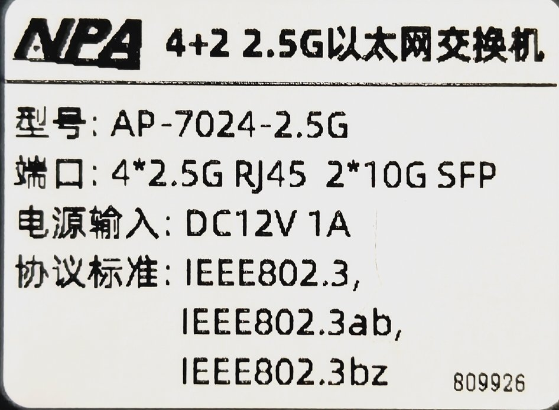
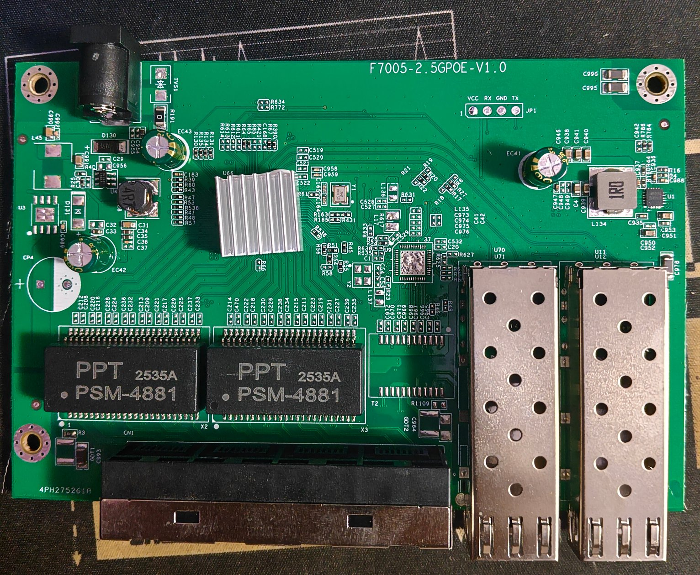
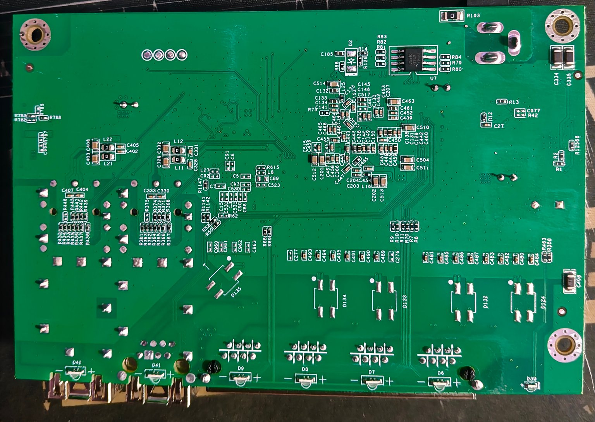

# F7005-2.5GPOE-V1.0

RTL8372-based 4 × 2.5GBASE-T + 2 × SFP+ unmanaged switch, sold by NPA as
**AP-7024-2.5G** (label `型号 AP-7024-2.5G`, `端口 4*2.5G RJ45 2*10G SFP`,
DC 12 V 1 A). PCB silkscreen: `F7005-2.5GPOE-V1.0`.

Machine target: `MACHINE_F7005_2_5`, built with `FLASH_NO_DIO=1`.
**Status: supported — LAN, LEDs and both SFP cages at 10G were verified on
the unit (2026-10-19). The final unit runs a 2 MiB BY25Q16BS; with that part
the SFP cages are detected automatically and the web firmware upgrade works.
The original 512 KiB T25S40 also works, but only with the startup-config
workaround described below.**

## Label and PCB



Top side:



Bottom side:



- SoC: **RTL8372** under the heatsink (`regget 0004` = `0x83727000`)
- Flash: originally **512 KiB BrightMoon T25S40** (`5e 32 13`); the final
  unit carries a **2 MiB BY25Q16BS** (`68 40 15`) so that the web updater can
  stage an image. T25S40 had to be programmed with an SPI clip/desoldering.
- Magnetics: 2 × `PPT 2535A / PSM-4881`
- No reset button and no footprint for one
- Console header `JP1`: VCC, RX, GND, TX (left to right)

## Build and install

```
make MACHINE=F7005_2_5 FLASH_NO_DIO=1
```

The image is 512 KiB and fits the T25S40 exactly; write it at offset 0 with
an SPI programmer (SOP8 clip or desoldering).

**The web firmware upload cannot be used on this board.** The running
firmware stages an update at `0x80000` and therefore requires at least 1 MB
of flash; on the 512 KiB part it answers HTTP 400
`Flash too small for firmware upload!`. This is a hard limit of the update
path, not a configuration error.

## Port layout

| Front panel | Logical port | Physical port | Type |
|---|---|---|---|
| RJ45 1 | 4 | 1 | Copper |
| RJ45 2 | 5 | 2 | Copper |
| RJ45 3 | 6 | 3 | Copper |
| RJ45 4 | 7 | 4 | Copper |
| SFP1 (left) | 8 | 5 | SFP+ (SDS1) |
| SFP2 (right) | 3 | 6 | SFP+ (SDS0) |

All four copper ports run at 10/100/1000/2500 Mbps.

## LEDs

The RTL8372 reset value of `LED_GLB_IO_EN` is `0x77ffff00`, which disables
the LED pads this panel uses. The target's `machine_custom_init()` writes
`0x7fffffff`; without it the whole panel stays dark.

The front-panel lamps are bi-colour: **2.5G = green, 1000/100M = orange**.
The pads were measured one group at a time:

| Port | Green (2.5G) | Orange (1G/100M) |
|---|---|---|
| RJ45 1 (logical 4) | pad 3 | pads 4-5 |
| RJ45 2 (logical 5) | pad 6 | pad 8 |
| RJ45 3 (logical 6) | pads 9-10 | pads 12-14 |
| RJ45 4 (logical 7) | pads 18-20 | pads 21-23 |
| SFP1 (logical 8) | pads 24-27 | — |
| SFP2 (logical 3) | pads 0-1 | — |

Pads 2, 7, 11 and 15-17 drive nothing measurable and are pointed at `0x02`
(a never-true signal), not `0x3f`: a floating pad lights its lamp.

The 2.5G lamp (set 0, slot 0) carries `LEDS_ACT`, so it blinks while data
flows. The first version had `2G5|LINK` only and left the lamp solid during
traffic - the same defect that was found and fixed on the IG204, see *Link
lamps blink with traffic* in [STEAMEMO_IG204_V1.md](STEAMEMO_IG204_V1.md). The
bit is also set by the SWTG024AS and Hi-K0801WS targets. The blink itself was
not watched on this unit; only the pad map and the lamp colours were measured
here.

## SFP cages

Detect and EEPROM pins were measured by inserting one module at a time and
by reading the EEPROM through the I2C controller with each candidate pin
pair:

| Cage | Detect | RX_LOS | EEPROM I2C |
|---|---|---|---|
| SFP1 (left, logical 8) | GPIO38 (low when inserted) | not mapped | SDA1/SCL1 = GPIO49/48 |
| SFP2 (right, logical 3) | GPIO37 (low when inserted) | not mapped | SDA0/SCL0 = GPIO47/46 |

Both test modules were 10G SFP+ (EEPROM identifier `0x03`, Encoding `0x06`,
Rate `0x67`). GPIO34 also goes low when a module is inserted in SFP1; it is
a TX_DISABLE/LOS candidate, but the links work without driving it.

The detect and EEPROM pins are **not** the reference values (`GPIO30/50`,
`SDA4/3 + SCL3`) used by the other 4+2 boards. The target carries the
measured values above.

## 2 MiB BY25Q16BS upgrade

The 512 KiB T25S40 is below the 1 MB staging area the web updater needs, so
the board was moved to a **2 MiB BY25Q16BS** (same 25-series SOP8 footprint).
Write `rtlplayground-F7005_2_5-2M-v3-nodio.bin` at offset 0 (full chip erase,
write, verify). `flash j` then reports `68 40 15 = 2 MB`, the web interface
reports `flash_size: 2 MB`, and firmware upgrades work from the web UI.

With the 2 MB part and the v3 target, both cages are detected automatically:

```
> sfp
Slot 1 - Rate: 67  Encoding: 06
JDSU            PLRXPLSCS43HW
...
Slot 2 - Rate: 67  Encoding: 06
JDSU            PLRXPLSCS43HW
```

`stat` reports `SFP IN / 10G` on physical port 5 or 6 depending on which cage
holds the module. The old `sdsset` workaround is not needed on this part.

## Workaround on a 512 KiB board

Because the web updater cannot install a new image on the 512 KiB part, the
unit was brought fully up with startup-configuration commands instead of a
firmware write:

- the measured LED map (`regset 65dc/65e0/65e4/65e8/65ec/65f0/65f4/6544`)
- `regset 7b20 00000b5a` (SDS0 and SDS1 both `SDS_10GR` = 0x1a)
- the `sds_config(..., SDS_10GR)` write sequence for both SerDes
  (`sdsset 1 ...` and `sdsset 0 ...`)

The startup configuration is replayed on every boot. Verified after a
reboot: `sds` = `0x00000b5a`, SFP2 (physical port 6) links at 10G, passes
traffic and lights its LED; LAN LEDs follow the measured map. The `sfp`
command and `stat` still say "empty"/"NO SFP" on that build because the
compiled machine table has the old detect/I2C pins; the ports themselves
work. The `MACHINE_F7005_2_5` image above fixes the reporting as well.

The workaround assumes 10G modules. A 1G/2.5G module needs the matching SDS
mode instead.

## Console

- Stock firmware: 9600 8N1, prompt `RTL8371B:`; `dump 3 <sds>` answers for
  SDS0/SDS1, `dump 4` (RTL8224) stays silent, i.e. the 4-PHY/2-SerDes
  profile.
- RTLPlayground: 115200 8N1.
- `GPIO38`/`GPIO37` are the SFP1/SFP2 detect pins; `GPIO49/48` and
  `GPIO47/46` are the two EEPROM buses.

## Verified

| Item | Result |
|---|---|
| SoC | RTL8372 (`regget 0004` = `0x83727000`) |
| Flash | T25S40 512 KiB (`5e 32 13`) and BY25Q16BS 2 MiB (`68 40 15`), both with `FLASH_NO_DIO=1`; both boot |
| LAN 1-4 | 2.5G links and traffic |
| LAN LEDs | measured map; 2.5G green, 1G/100M orange (LAN2 checked both colours); both slots carry `LEDS_ACT` so they blink with traffic (fix shared with the IG204, not watched on this unit) |
| SFP1 | v3 + 2 MiB part: `sfp` reads JDSU PLRXPLSCS43HW, `stat` SFP IN / 10G (SDS1) |
| SFP2 | same module moved to the right cage: `sfp` reads it on SDA0/SCL0, `stat` SFP IN / 10G (SDS0) |
| Web update | works on the 2 MiB part; refused on 512 KiB (needs a >=1 MB staging area) |
