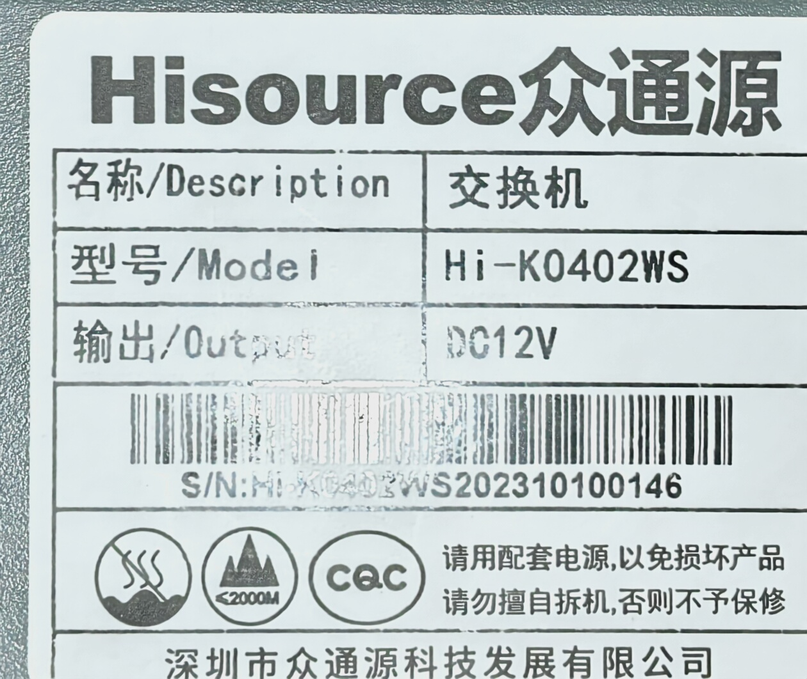
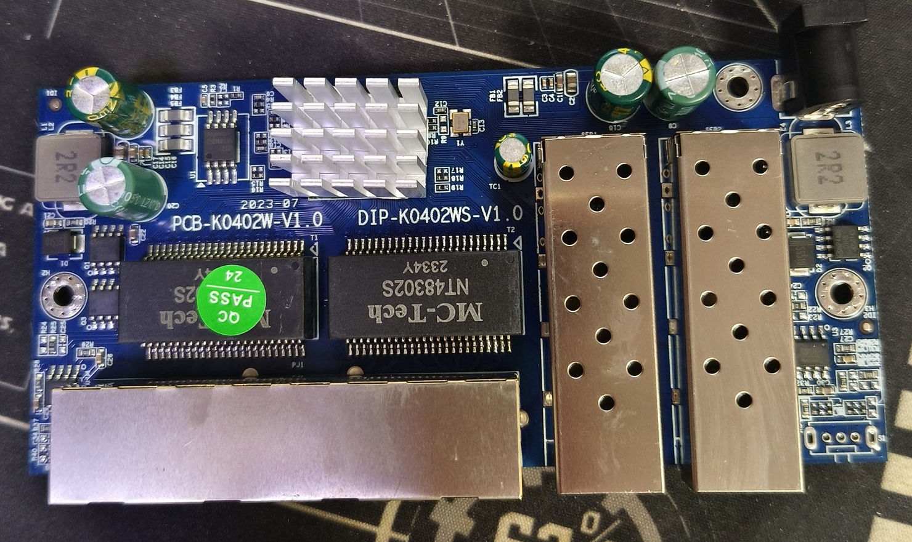
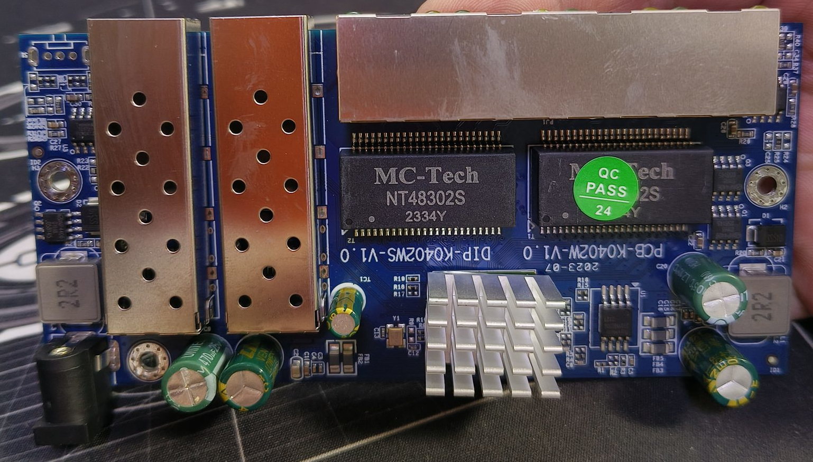
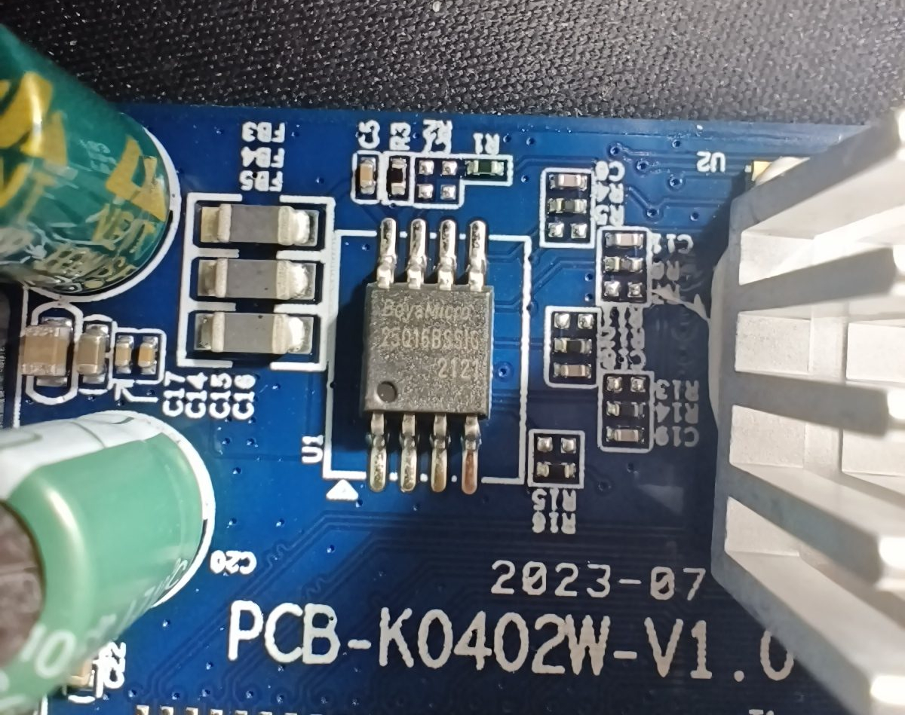
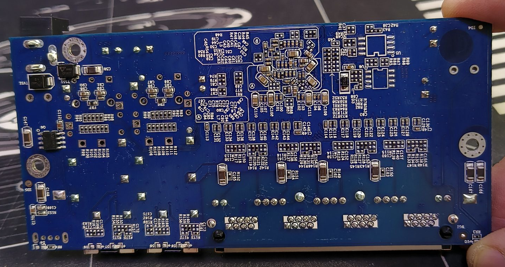

# PCB-K0402W-V1.0

RTL8372-based 4 × 2.5GBASE-T + 2 × SFP+ unmanaged switch, sold as Hisource Hi-K0402WS
(众通源). Older PCB revision of the [PCB-K0402WS-V2.0](PCB-K0402WS-V2.0.md) and
[PCB-K0402WS-V3.0](PCB-K0402WS-V3.0.md) boards — all three share the silkscreen family
(`PCB-K0402W-Vx.y` / `DIP-K0402WS-Vx.y`), and RTLPlayground names them `PCB_K0402WS_*` /
`PCB_K0402W_*` after the silkscreen revision.

**Status: SUPPORTED — verified on hardware (2026-10-11 … 2026-10-13), listed in
[doc/supported_devices.md](../supported_devices.md).**
Machine target: `MACHINE_PCB_K0402W_V1` (see `machine.h`), built with `FLASH_NO_DIO=1`
(this board's flash chip needs it — see below).

## Label specifications

- **Manufacturer**: HISOURCE / 深圳市众通源科技发展有限公司 (the board is also sold
  under other brands)
- **Model**: Hi-K0402WS
- **Ports**:
  - 4 × RJ45: 10/100/1000/2500 Mbps
  - 2 × SFP+: 1G / 2.5G / 10G
- **Original software**: unmanaged Realtek reference firmware with a factory-test
  console, UART at **9600 8N1**, no web interface

The label on the owner's unit reads `Hisource众通源 / 交换机 / 型号 Hi-K0402WS /
输出 DC12V`, with the serial number `Hi-K0402WS202310100146`:



## What works

Verified on two units of this board:

- Firmware boots, detects the SoC (RTL8372), initialises the switch and comes up on
  192.168.10.247
- All four front-panel LAN ports (physical ports 1-4) at 10/100/1000/2500 Mbps
- Both SFP+ cages: module detect and RX_LOS on the pins below, module EEPROM readable
  over I2C, port links (10G module) and the SFP LED lights
- Copper LEDs: amber = 2.5G, green = 1G/100M/10M with activity (both seen with real
  links, including a 2.5G peer)
- Restoring the configuration built into the image works (web UI *Restore factory
  defaults*, or the `defaults` console command)
- `gpio` and `leds` console commands work, so any remaining parameter can be measured
  in-circuit without extra hardware
- The front-panel power LED is hard-wired and stays lit even with the system-LED bits
  cleared, so `high_leds` cannot be observed on this board (and drives nothing)

## Flash chip quirk: DIO MMIO reads fail, build with FLASH_NO_DIO=1

This board carries a **Boya/BoHong BY25Q16BS** (RDID `68 40 15`, 2 MiB). With the default
firmware image the board did not boot: it printed

```
Initializing Flash controller
Detecting CPU: RTL8372
```

and then reset every ~10 ms, forever. The reason is that the 16 KiB HOME area is
prefetched into code RAM by the ROM at power-up (so it runs fine), while every fetch
from a code bank goes through the flash controller's MMIO window, which the default
`flash_init(1)` configures for **Dual-I/O fast read (`0xBB`, mode byte 0x18, 4 dummy
cycles, divider 4)** — and this flash chip returns garbage for that mode. The chip itself
is fine: the written image was read back with two independent programmers and matched
byte for byte, and the flash works in single-bit mode (which is what the later
`Flash information:` probe uses to read the RDID).

Building with single-bit fast read (`0x0B`, 8 dummy cycles, divider 8) fixes it:

```bash
make MACHINE=PCB_K0402W_V1 FLASH_NO_DIO=1
```

The fix is a build-time option rather than a change of the default, because the
Dual-I/O path is an optimisation that works on the other supported boards. The
[PCB-K0801W-V1.0](PCB-K0801W-V1.0.md) board carries the same part family and needs the
same option.

## Boot log on this board (after the fix)

```
Initializing Flash controller
Detecting CPU: RTL8372
Software version: v0.1.0-0170943-dirty
Hardware: PCB-K0402W-V1.0
NIC reset
Setting MAC to: ...
init_switch called
CPU revision: 6868
leds_setup called / leds_setup done
rtl8372_init called ... rtl8372_init done
Flash information: Manufacturer ID: 0x68  Memory Type: 0x40  Capacity: 0x15 = 2 MB
Configuring I2C for SFP idx=00 SCL=03, SDA=04 / idx=01 SCL=03, SDA=03
Verifying PHY settings:
 Port 6 NO SFP Down / Port 1..4 On Down / Port 5 NO SFP Down
Setting ip: 192.168.10.247
```

`regget 0004` returns `0x83720000`, i.e. the SoC is an **RTL8372** (byte 1 = 0x72, not
0x73) — the "RTL8371B" in the stock firmware's banner is the Realtek SDK's name for this
silicon generation, not a different, unsupported chip.

The web UI states the board and the retail model on separate lines, taken from
`.machine_name` and `.model_name` of the machine block:

```
硬件 (hardware): PCB-K0402W-V1.0
型号 (model):    Hi-K0402WS
```

## PCB overview

**Board markings**
- Top silkscreen: `PCB-K0402W-V1.0` / `DIP-K0402WS-V1.0`
- Date code: `2023-07` (V2.0/V3.0 boards are newer revisions of the same layout)

**Key components**
- `U2`: SPI NOR flash, **8-pin, 2 MiB** — BeyoMicro `25Q16BSSIG` (16 Mbit). A single
  flash chip, unlike the V3.0 board which has two with a selector switch.
- Switch SoC is **under the heatsink**, so the part marking (RTL8371B / RTL8372 /
  RTL8373) is not visible in the photos and has to be read from the boot console.
- Power section: `MC-Tech NT48302S` with `2R2` inductors.
- Ports: 4 × RJ45 2.5GBASE-T + 2 × SFP+ (same chassis/port layout as the V2.0/V3.0
  boards: SFP left, 4 × RJ45, SFP right).
- `QC PASS 24` sticker, same as the sibling revisions.
- **No reset button and no unpopulated footprint for one** — see below.

PCB overview, with the board markings and the date code



Second view (power section, `QC PASS` sticker)



Flash chip `U2` — BeyoMicro `25Q16BSSIG`, 2 MiB



Component detail



## Port layout

Identical to the [PCB-K0402WS-V2.0](PCB-K0402WS-V2.0.md) board, whose parameters this
target inherits. Verified for all six ports on this revision (one cable per jack, plus a
module in each SFP cage).

| Front panel position | Logical port | Physical port | Type    |
|----------------------|--------------|---------------|---------|
| SFP left             | 8            | 5             | SFP+    |
| RJ45 1               | 4            | 1             | Copper  |
| RJ45 2               | 5            | 2             | Copper  |
| RJ45 3               | 6            | 3             | Copper  |
| RJ45 4               | 7            | 4             | Copper  |
| SFP right            | 3            | 6             | SFP+    |

## LED configuration

Copper ports use LED SET0, SFP ports use LED SET1 — verified on the board.

| SET  | LED0                                          | LED2                                   |
|------|-----------------------------------------------|----------------------------------------|
| SET0 | Amber — lights on 2.5G link                   | Green — lights on 1G / 100M / 10M link with activity |
| SET1 | All speeds — lights on any link with activity | —                                      |

`high_leds` (the system/power LED) is the one field that cannot be checked on this board:
the front-panel power LED is hard-wired and stays lit even after clearing the system-LED
bits (17:16) of `RTL837X_REG_LED_MODE`, so nothing on the panel is controlled by it. The
value is inherited from the sibling board and harmless.

## SFP GPIO assignments

Inherited from, and identical to, [PCB-K0402WS-V2.0](PCB-K0402WS-V2.0.md); verified on
this board by inserting a module into each cage in turn and reading its EEPROM over I2C.

| SFP               | pin\_detect (ModAbs)         | pin\_los                      | SerDes | I2C SDA                  | I2C SCL                   |
|-------------------|------------------------------|-------------------------------|--------|--------------------------|---------------------------|
| Left (logical 8)  | GPIO30\_ACL\_BIT3\_EN        | GPIO37                        | SDS1   | GPIO39\_I2C\_SDA4        | GPIO40\_I2C\_SCL3\_MDC1   |
| Right (logical 3) | GPIO50\_I2C\_SCL2\_UART1\_TX | GPIO51\_I2C\_SDA2\_UART1\_RX  | SDS0   | GPIO41\_I2C\_SDA3\_MDIO1 | GPIO40\_I2C\_SCL3\_MDC1   |

`pin_tx_disable` is GPIO\_NA on both ports.

## No reset button

This board has **no reset button and no unpopulated footprint for one**: the front-left
area of the PCB carries neither a 4.5 × 4.5 mm push-button footprint (compare
[KP-9000-6XH-X2](KP-9000-6XH-X2.md#reset-button), where that footprint exists unpopulated
and the case even has the hole) nor a spare pad to solder one to. `.reset_pin` is
therefore `GPIO_NA` for this target — the firmware would have nothing to read.

To restore the configuration built into the image, use the **Restore factory defaults**
button in the System tab, or the equivalent console command `defaults`; both were added
for exactly this case and do what a long press of the reset button does elsewhere (see
the [README](../../README.en.md#8-the-web-interface)). The board then takes the address the
image was built with, i.e. `config.txt` here, and not the address it had before.

## Serial console

RTLPlayground runs its console at **115200 8N1** on the board's UART pads; the stock
firmware uses **9600 8N1** on the same pads. `tools/console_capture.py` records either
without needing pyserial. The unpopulated three-hole footprint near the edge is wired to
UART0; on the siblings the leftmost hole is RX (GPIO32\_UART0\_RX), the middle one GND
and the rightmost TX (GPIO31\_UART0\_TX).

## Programming

Using a SPI clamp in-board is the only method for the initial installation (the stock
firmware is an unmanaged Realtek reference firmware with a factory-test console, no
web interface, so the web-upgrade path of the OEM installer is not available).

For flashrom/IMSProg the built image must be padded to the chip size:

```bash
make MACHINE=PCB_K0402W_V1 FLASH_NO_DIO=1
truncate -s 2097152 output/PCB_K0402W_V1/rtlplayground-*-PCB_K0402W_V1.bin
```

Do **not** use the padded file for web flashing or for a RTLPlayground web upgrade. Keep
the 2 MiB dump of the untouched chip for rollback (see below).

## Stock firmware dump analysis

A programmer dump of an untouched board (kept as `Hi-L0402WS-20250527.bin` — the file
name was chosen before the case label was read, the unit is labelled Hi-K0402WS —
2 MiB, sha256 `6d73dcd9a30fc3d735b16b7ceba4caa06c82dc3e26b69f8879229f4be56876e0`) was
analysed:

| Property | Stock image | RTLPlayground image | Verdict |
| --- | --- | --- | --- |
| Flash size | 2 MiB (`25Q16BS`) | 512 KiB image, pad to 2 MiB | compatible |
| Boot header | `00 40` (prefetch 0x4000) | `00 40` | identical contract |
| Layout | common code at 0x0002, banks at 0x4000/0x10000 (3 banks) | same scheme, 4 banks | identical contract |
| Used range | 0x00000 – 0x1369A, rest `0xFF` | 0x00000 – 0x7FFFF | — |
| Factory data | none (no MAC/calibration stored in flash) | — | nothing to preserve |
| Firmware | Realtek reference/diag firmware, `RTL8371B:` prompt | RTLPlayground | — |

The layout contract matches the description in [doc/ghidra.md](../ghidra.md), so the
boot ROM will accept an RTLPlayground image written at flash offset 0. The stock
firmware is byte-for-byte the same firmware family as the one seen on the Keeplink
KP-9000-6XH-X (same console prompt, same `?` factory-test menu), i.e. the same
"RTL8371B" silicon generation that RTLPlayground already supports.

**What the dump cannot provide:** the board-specific LED/GPIO wiring. A scan of the
stock image finds **zero** writes of any 0x65xx switch-register address
(`MOV DPTR,#0x65xx` and `MOV direct,#0x65` patterns), whereas RTLPlayground's own build
contains 70 such sites; the stock SDK evidently reaches the LED/GPIO registers through a
different, computed access path. `.led_mux`, `.led_sets`, `.port_led_set` and the SFP
GPIO pins therefore cannot be read out of the flash dump and were measured on the board
instead (see the verification sections below).

## Console / chip identification

The stock firmware was confirmed on this board over TTL at **9600 8N1**: it boots to the
prompt `RTL8371B:` and offers the factory-test menu (`rst`, IOL test modes, SDS test
modes, `chip sel: 8373/8372: 3, 8224: 4`). That output is byte-for-byte the same firmware
as in the flash dump (`RTL8371B start ` at offset 0x32A6, `RTL8371B:` at 0x2D91), which
confirms the dump is a genuine read of this board.

The `RTL8371B` banner is a **string compiled into the stock firmware** (the Realtek SDK
build target name), not something RTLPlayground reads. RTLPlayground identifies the SoC
by reading `RTL837X_REG_CHIP_ID` (register 0x0004) and looking at byte 1: `0x73` means
RTL8373, anything else is treated as RTL8372 (`rtlplayground.c`, `Detecting CPU:` /
`INCORRECT MACHINE!`). On this board the first console lines print
`Detecting CPU: RTL8372` with no warning, and `regget 0004` shows `0x83720000`.

## Console evidence gathered from the stock firmware

Read directly from the board's UART (`/dev/ttyUSB0`, 9600 8N1) with
`tools/console_capture.py`:

| Test | Result | Interpretation |
| --- | --- | --- |
| `?` | full factory menu (1509 bytes) | console accessible; menu is the complete command set |
| 13 candidate hidden commands (`help`, `i2c`, `reg`, `rd`, `rreg`, `ee`, `pse`, `phy`, `ver`, `info`, …) | all unknown (echo + prompt) | **no register read/write command exists** — LED/GPIO config cannot be read from this console |
| `dump` → `3` → `0` and → `1` | both channels: `pre_en=0x1; pre_amp=0x1; main_en=0x1; main_amp=0x0; main_boost=0x1; post_en=0x1; post_amp=0x1; tx_z0=0x4` | **both SerDes exist and are initialised** → 2 SFP slots, matches `.n_sfp = 2` |
| `dump` → `4` (RTL8224) | no data | **no external RTL8224 PHY** → the 4 copper ports use the SoC's internal PHYs, i.e. the 4-PHY/2-SerDes (RTL8372) profile, not the 8-copper + 8224 (RTL8373) profile |
| cold boot (real power cycle) | output is exactly `\n\nRTL8371B start \n` | this board's ROM does **not** print the `SERDES_*` / register-triple diagnostics seen on the KP-9000-6XH-X, so the boot log carries no additional board configuration |
| `rst` (chip reset) | prints `chip reset` / `RTL8371B start` only | the diagnostics above come from the ROM at cold boot, not from this command |

Note when talking to this console: hold the port open **read-write**. With a read-only
fd the switch's RX input floats and the firmware echoes a prompt for every noise byte,
flooding the log with `RTL8371B:` lines.

## LED behaviour and how it was verified

Each copper port has two LEDs side by side: **left = orange, right = green**. The stock
firmware lights orange for a 2.5G link and green for 1G/100M/10M, which is exactly the
semantics of the inherited `PCB_K0402WS_V2.0` LED set:

```
SET 0 (copper): id0 = LEDS_2G5  | LEDS_LINK | LEDS_ACT     -> orange
                id1 = 0
                id2 = LEDS_1G | LEDS_100M | LEDS_10M | LEDS_LINK | LEDS_ACT -> green
                id3 = 0
SET 1 (SFP):    id0 = all speeds | LEDS_LINK | LEDS_ACT
```

Verified in two steps:

1. **Observation** — with a 1G link on a front port the *green* LED is on and it blinks
   while pinging through the port (so `id2` and its LED pad are correct).
2. **Register experiment** — with the same 1G link, `LED1_0_SET0` was set to `0x00000174`
   (id0 = the 1G condition) and `LED3_2_SET0` to `0`:

   ```
   regset 6548 00000174     # LED1_0_SET0: id0 = 1G|100M|10M|LINK|ACT
   regset 6544 00000000     # LED3_2_SET0: id2 = id3 = 0
   ```

   The green LED went dark and the **orange** LED lit up, proving that the orange LED is
   driven by `LED-id0` of SET0, i.e. that it will light at 2.5G with the stock-like
   definition. The original values were restored afterwards (`0x00000141` / `0x00000174`)
   and read back to confirm.

So for the copper ports `.port_led_set`, `.led_sets` and `.led_mux` all match this board.
The SFP LED (SET1) lights green while a module is linked; only the system/power LED is
uncontrolled because it is hard-wired.

## SFP verification (both cages)

A module was moved from one cage to the other and the console output compared. Both cages
report through the inherited pin assignment:

```
> sfp
Slot 1 - Rate: 67  Encoding: 06
JDSU            PLRXPLSCS43HW   2
Temp: 25e9  Vcc: 8076  TX Bias: 07d8  TX Power: 1784  RX Power: 190b
Slot 2 - empty
```

| Evidence | Result |
| --- | --- |
| `sfp`, module in the **left** cage | `Slot 1 - JDSU PLRXPLSCS43HW` with Temp/Vcc/TX/RX values, `Slot 2 - empty` |
| `sfp`, module in the **right** cage | `Slot 1 - empty`, `Slot 2 - JDSU PLRXPLSCS43HW` with the same values |
| `gpio`, left → right | GPIO word `0a3fdb9f` → `0a33dfbb`; the bits that differ are **50** and **51** (right cage detect/LOS) plus **37** (left cage LOS) |
| `sds` | `0x0000035f` → `0x0000035a`, i.e. the SerDes is re-armed for the other cage |
| Front panel | the SFP LED lights green with the port linked (SET1), and the port links at 10G |

## What was verified, and how

The parameters were copied from `PCB_K0402WS_V2.0` (the nearest documented revision, and
single-flash like V1.0) and then confirmed on the board:

| Parameter | Status |
| --- | --- |
| Flash size / boot compatibility | **verified** (dump analysis above) |
| Flash chip needs `FLASH_NO_DIO=1` | **verified** (boot loop → fixed → boots, reproducible build) |
| 4 × copper + 2 × SFP+, no external PHY | **verified** (photos, port layout, sibling defs, `dump` on the stock console) |
| `isRTL8373 = 0` (RTL8372) | **verified** — boot prints `Detecting CPU: RTL8372`, `regget 0004` = 0x83720000 |
| Both SFP slots and 4 copper ports present | **verified** — boot prints `Port 1..4 On`, `Port 5/6 NO SFP` |
| `log_to_phys_port` / `phys_to_log_port` | **verified** — a cable in front LAN 1/2/3/4 brings up physical port 1/2/3/4 respectively (checked on the console with `port <phys> show`) |
| SFP `pin_detect` / `pin_los` (GPIO30/37, GPIO50/51) | **verified for both cages** — inserting a module flips the detect bit and makes `sfp` report the module; the LOS bit changes with the signal |
| SFP I2C pins (SDA4/SCL3 and SDA3/SCL3) | **verified for both cages** — `sfp` reads the EEPROM of a JDSU PLRXPLSCS43HW (vendor, part number, Temp/Vcc/TX Bias/TX Power/RX Power) |
| `led_sets` / `port_led_set` / `led_mux` | **verified for the copper ports** (orange = 2.5G, green = 1G/100M/10M + activity, both confirmed on hardware incl. a real 2.5G link) and for the SFP set (LED lights with a linked module) |
| `high_leds` mux/enable | **not applicable** — the only non-port LED on the panel is a hard-wired power LED: it stays lit even after clearing the system-LED bits (17:16) of `RTL837X_REG_LED_MODE`. No SoC-driven system LED was found, so the inherited value is harmless |
| Reset button | **not present** — no button and no footprint for one (see above) |

## Flash upgrade and rollback

Keep the 2 MiB dump. Restore it with the same programmer and the board is back to stock —
the analysis above shows nothing outside the first 0.5 MiB is used by the stock firmware,
and the unused area is erased (`0xFF`), so a full-chip restore is a faithful rollback.

Once RTLPlayground runs on the board, later versions are installed from the web interface
(*Firmware update*), which writes the 512 KiB image and leaves the startup configuration
alone — see the [README](../../README.en.md#4-installation-through-the-web-interface-software-way).
