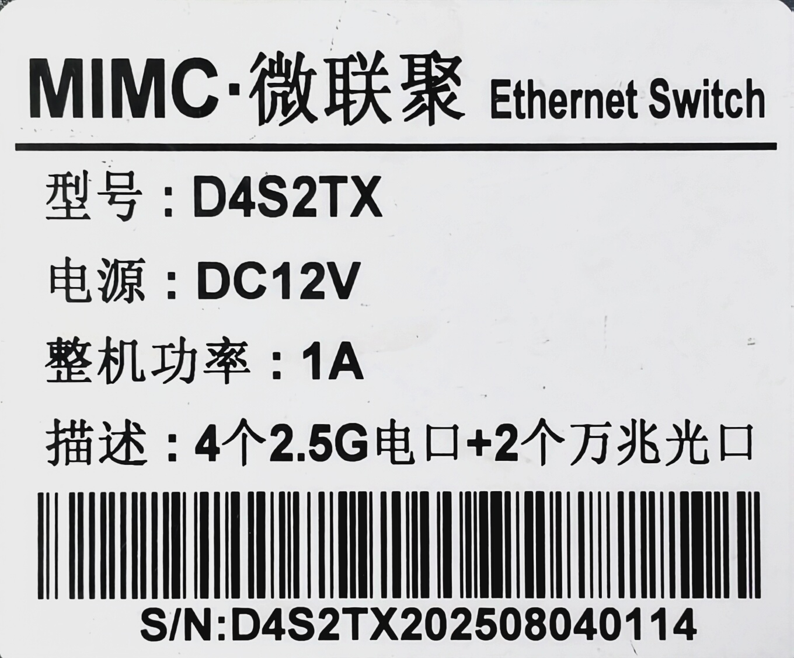
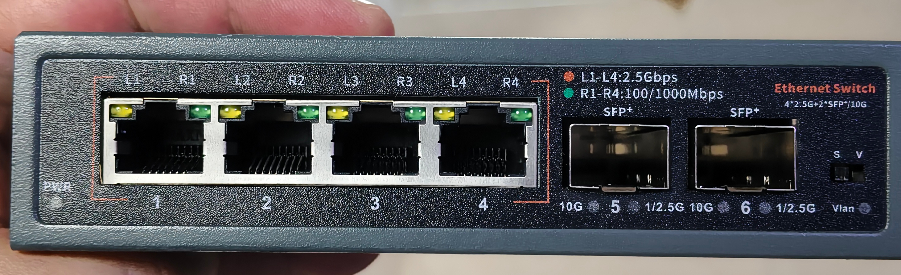
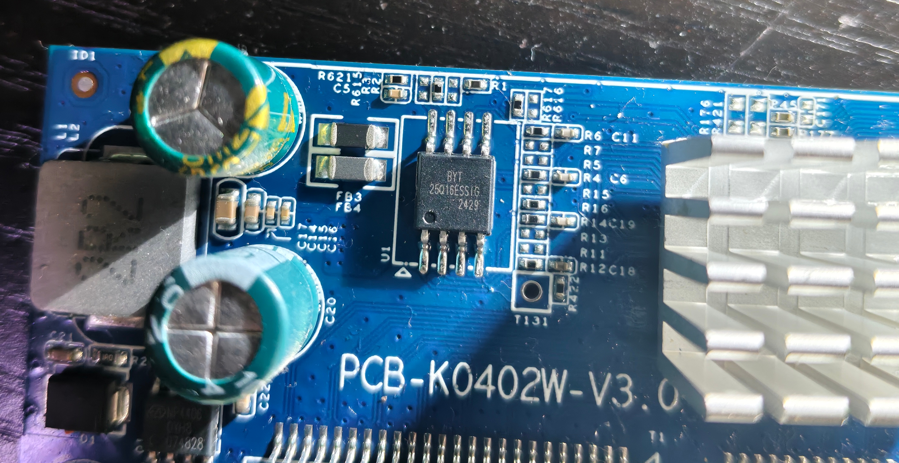
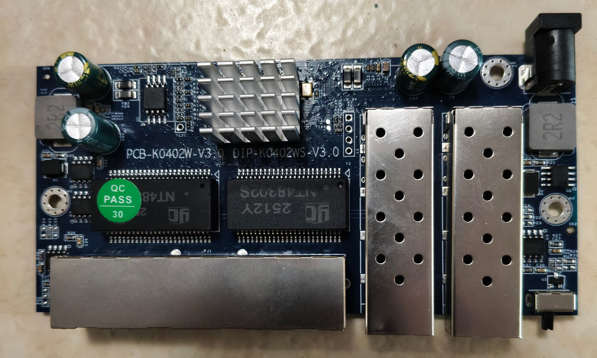
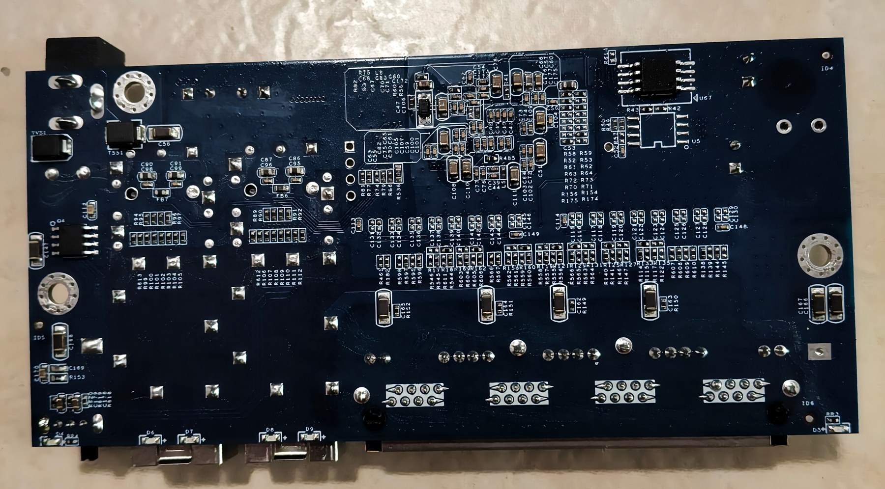

# PCB-K0402W-V3.0 — MIMC D4S2TX

RTL8372-based **4 × 2.5GBASE-T + 2 × SFP+ (1G/2.5G/10G)** unmanaged switch,
silkscreen `PCB-K0402W-V3.0` / `DIP-K0402WS-V3.0`, sold as **MIMC · 微联聚
D4S2TX**. It is the V3.0 revision of the [PCB-K0402WS-V3.0](PCB-K0402WS-V3.0.md)
board family; the front "Vlan S/V" switch is **not** a VLAN switch — it selects
one of the two fitted flash chips, see [below](#the-front-sv-switch-is-the-flash-selector).

Machine target: **`MIMC_D4S2TX`**
(`machine/MIMC_D4S2TX.c` → `machine/pcb/PCB_K0402W_V3_0__MIMC.c`).

> [!IMPORTANT]
> **Status: supported — verified on four units (2026-11-17), all on v0.1.15.**
> Boot, web UI, both flashes, all four RJ45 ports and every panel lamp (L1-L4,
> R1-R4 and both SFP cages) work. The LED configuration is borrowed unchanged
> from the upstream `PCB_K0402W_V3_0` target; the System page shows a single
> **Model: MIMC D4S2TX** row in the hardware slot and PCB **PCB_K0402WS-V3.0**,
> with no hardware row.

## Label

- **Brand / model**: MIMC · 微联聚 **D4S2TX**
- **Description on the label**: `4个2.5G电口+2个万兆光口` (4 × 2.5G RJ45 + 2 × 10G SFP+)
- **Power**: DC 12 V, 1 A
- **S/N** of the documented unit: `D4S2TX202508040114`



Front panel: RJ45 1-4 with an amber **L** LED (2.5 G) and a green **R** LED
(100/1000 M) each, SFP+ 5 and 6 with a **10G** and a **1/2.5G** lamp each, the
**S/V** slide switch at the right end and the **Power** lamp (hard-wired, always
on).



## The front S/V switch is the flash selector

The switch labelled **Vlan S/V** on the case is a **hardware flash selector**,
measured on the unit 2026-11-17:

| Position | Flash | Board side |
|---|---|---|
| **S** (left) | `U1` | top, next to the front edge |
| **V** (right) | `U67` | bottom |

Both are the same 2 MiB 25Q16ES-class part. The switch drives the two chips'
**HOLD** lines, so only the selected chip is visible to the SoC, and flipping
it while the switch is running reboots it into the other chip. There is no GPIO
involved, so this target has no `vlan_switch_pin` and the "VLAN panel switch"
card does not appear in the web UI. The "Vlan" printing comes from the shared
case, not from a VLAN function.

Keep the switch on the chip that holds the firmware you want to run. The two
chips can hold two independent images; a clip programmer also writes whichever
chip the switch selects unless the clip drives HOLD itself.



## Flash: 2 MiB, single-IO

| | |
|---|---|
| `U1` (front) | 2 MiB, marking `BYT 25Q16ESSIG` |
| `U67` (back) | 2 MiB, same 25Q16ES family |
| Flash mode used | **single-bit fast read** (`.flash_sio = 1`) |

**Does it need no-DIO?** The fitted parts are Boya `25Q16ES`; the same build
family is used on the V1.0/V2.0 boards, whose `BY25Q16BS` reset-loops on this
flash controller with Dual-I/O MMIO reads (see
[PCB-K0402WS-V1.0](PCB-K0402WS-V1.0.md)). The target therefore reads single-bit
from the first instruction on, which is what `FLASH_NO_DIO=1` does for the older
boards, baked into the machine definition so the image cannot be built the wrong
way. The cost is management CPU speed only; the ASIC keeps forwarding in
hardware.

If a future revision turns out to have a flash that is happy in Dual-I/O, remove
`.flash_sio = 1` from the board definition and rebuild.

## Build

```bash
make MACHINE=MIMC_D4S2TX
```

No `FLASH_NO_DIO=1` is needed. The image appears as
`output/MIMC_D4S2TX/rtlplayground-<version>-MIMC_D4S2TX.bin`.

## Install

The stock firmware is an unmanaged Realtek reference image, so the first
installation is **SPI-clamp only**: back up the 2 MiB chip first, then erase and
write the build. For a programmer, pad the 512 KiB image to the chip size:

```bash
truncate -s 2097152 \
  output/MIMC_D4S2TX/rtlplayground-v0.1.14-<git>-MIMC_D4S2TX.bin
```

Never upload the padded file through the web UI — use the original 512 KiB
`.bin` for web flashing. The 2 MiB flash is large enough for the web updater.

Serial console: **115200 8N1** on the 4-pin `J2` header
(`3V3 / RX / TX / GND`, from the top down with the ports facing down). The stock
firmware on the other chip speaks 9600 8N1.

## System page

The board definition sets `machine_name = "MIMC D4S2TX"`, `MACHINE_PCB_INFO =
"PCB_K0402WS-V3.0"` and leaves `model_name` empty, so the System page shows:

| Row | Value |
|---|---|
| 型号 / Model | `MIMC D4S2TX` (in the hardware slot, after uptime) |
| PCB | `PCB_K0402WS-V3.0` |
| 硬件 / Hardware | *not shown* |

## Port map

Measured layout of the PCB-K0402W family; identical on the V1.0 board and
confirmed by the web UI's port list on this unit.

| Front panel | Logical port | Physical port | LED set |
|---|---|---|---|
| SFP left (5) | 8 | 5 | SET1, SDS1 |
| RJ45 1 | 4 | 1 | SET0 |
| RJ45 2 | 5 | 2 | SET0 |
| RJ45 3 | 6 | 3 | SET0 |
| RJ45 4 | 7 | 4 | SET0 |
| SFP right (6) | 3 | 6 | SET1, SDS0 |

## SFP cages

| Cage | Detect | RX_LOS | EEPROM I²C | SerDes |
|---|---|---|---|---|
| SFP left (logical 8) | GPIO38 | not wired | SDA4/SCL3 = GPIO39/GPIO40 | 1 |
| SFP right (logical 3) | GPIO37 | not wired | SDA3/SCL3 = GPIO41/GPIO40 | 0 |

The V3.0 board moved the cage pins: GPIO30 is the TP131 reset pad on this
revision, not the left cage's ModAbs as on V1.0/V2.0. GPIO38/GPIO37 are the
pins the verified upstream V3.0 target uses.

## LEDs

The panel has two lamps per RJ45 port (L = amber 2.5 G, R = green 1G/100M/10M)
and two per SFP cage (10G, 1/2.5G), plus the hard-wired Power lamp. There is no
SYS lamp.

The LED configuration is **taken unchanged from the upstream
`PCB_K0402W_V3_0` target**: its `led_mux`, `led_sets` and `high_leds`, plus the
`_init.c` hook that enables LED pad 6 (`reg_bit_set(LED_GLB_IO_EN, 6)`).
Flashing that target on this unit showed every lamp correct, and the same
configuration was verified on four MIMC units after the port.

## What is verified

| Item | State |
|---|---|
| Boot, web UI, DHCP, two 2 MiB flashes | verified on four units (2026-11-17) |
| S/V switch = flash selector (S = U1, V = U67) | verified |
| Port map, all four RJ45 ports | verified |
| LEDs: L1-L4, R1-R4, both SFP cages | verified on four units |
| System page: a single Model row `MIMC D4S2TX` in the hardware slot, PCB `PCB_K0402WS-V3.0`, no hardware row | verified via `/information.json` |
| Web firmware upload | fixed the missing `X-RTLP` header in `html/app.js`; browser uploads work again |

## PCB overview

- Top silkscreen: `PCB-K0402W-V3.0` / `DIP-K0402WS-V3.0`
- `U1`: 2 MiB flash, top near the front edge (`BYT 25Q16ESSIG`)
- `U67`: 2 MiB flash, bottom
- `SK1`: front-panel S/V flash-select switch
- `J2`: serial console `3V3 / RX / TX / GND`
- SoC under the heatsink; the case label does not state the part

Top side



Bottom side



## Related documents

- [PCB-K0402WS-V3.0](PCB-K0402WS-V3.0.md) — upstream document for the same PCB
  (its "Vlan switch" description is the shared-case printing; the switch is the
  flash selector)
- [PCB-K0402WS-V2.0](PCB-K0402WS-V2.0.md) — previous revision, measured pinout
- [PCB-K0402W-V1.0](PCB-K0402W-V1.0.md) — first revision, measured by this fork
