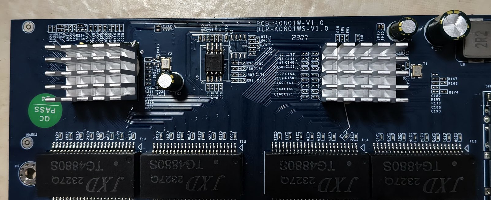
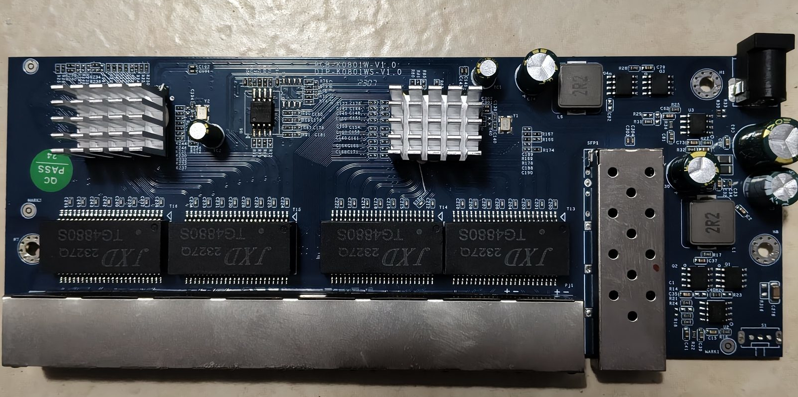
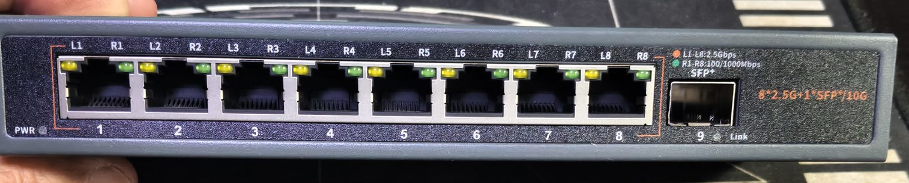
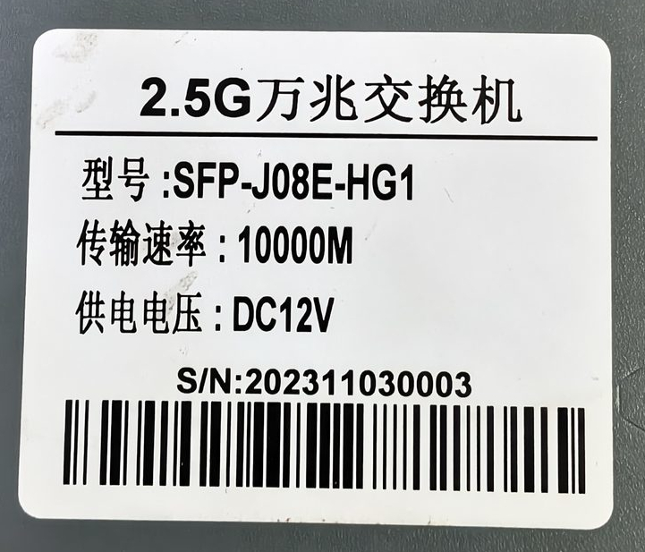
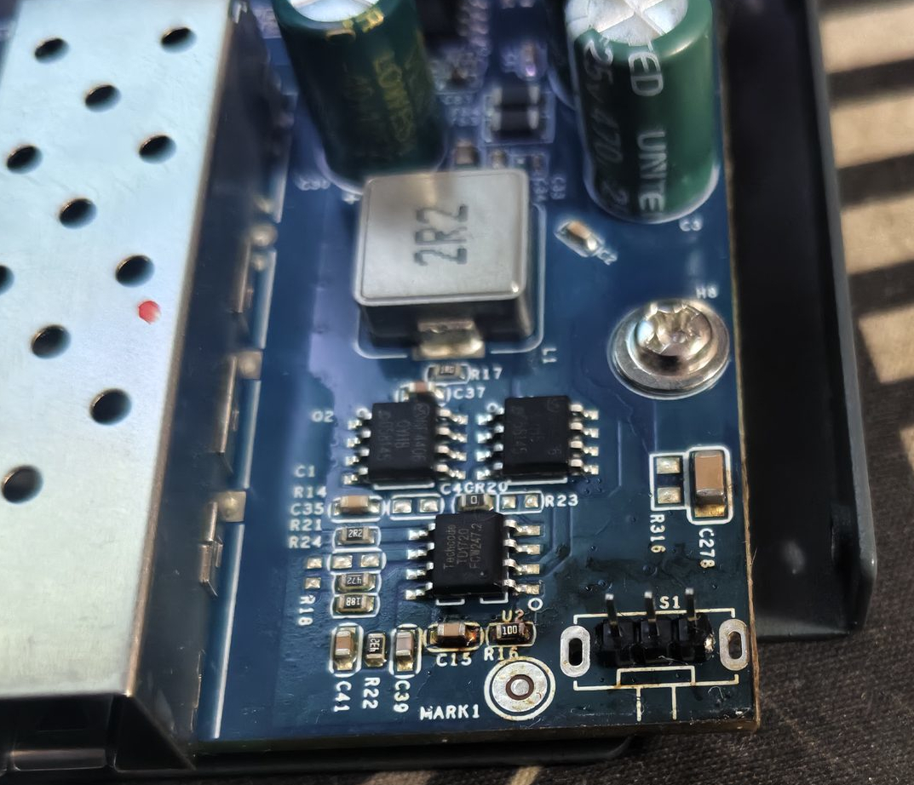
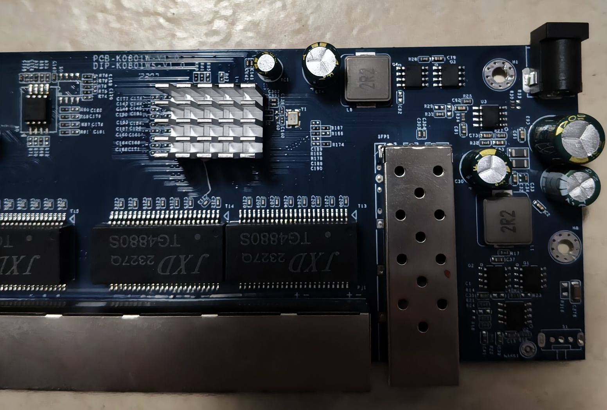
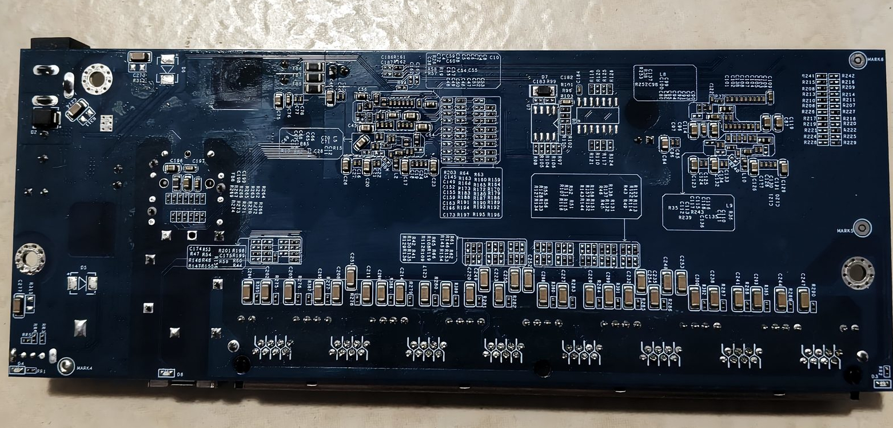

# PCB-K0801W-V1.0 (Hisource Hi-K0801WS, older PCB revision)

**Status: BOOTS ON HARDWARE — first bring-up succeeded on 2026-10-12.** The board boots,
runs normally and its web interface lists the ports correctly, which confirms the SoC class
(`isRTL8373 = 1`), the 8 + 1 port layout and the flash mode. The board-specific LED wiring
and the SFP pins are still inherited from V2.0 and unverified — see
[Bring-up status](#bring-up-status-2026-10-12). Not yet a supported device.

Machine target: `MACHINE_PCB_K0801W_V1` (see `machine.h`). It is derived from
`MACHINE_HI_K0801WS` — the target for [PCB-K0801W-V2.0](HI-K0801WS.md), the revision
currently in the supported-devices list — because the owner's board is the *earlier*
revision of the same retail model:

- Panel: 8 × RJ45 10/100/1000/2500 Mbps + 1 × SFP+ (same 8 + 1 layout as V2.0).
- Silkscreen: `PCB-K0801W-V1.0` / `DIP-K0801WS-V1.0`, date code `2307` — read from the
  board photos below (V2.0 boards read `PCB-K0801W-V2.0` / `DIP-K0801WS-V2.0`).
- Case label: `2.5G万兆交换机 / 型号 SFP-J08E-HG1 / 传输速率 10000M / 供电电压 DC12V`,
  serial number `202311030003`. That model name is what the firmware reports as 型号.
- No stock firmware dump of this board was taken. The spare flash of the same part
  family (see below) held the Realtek reference image of this device family, which is
  the same firmware the sibling 4 + 2 board ships.

The web UI states the board and the retail model on separate lines, taken from
`.machine_name` and `.model_name` of the machine block:

```
硬件 (hardware): PCB-K0801W-V1.0
型号 (model):    SFP-J08E-HG1
```

## Why every parameter is inherited from the V2.0 target

The V1.0 board has not been measured, and a stock firmware dump could not supply the
missing values even if one existed: the board-specific LED/GPIO wiring is not recoverable
from a Realtek reference image — a scan of the sibling 4+2 board's dump finds **zero**
writes to any `0x65xx` switch register address (the full scan and its consequence are
documented in [PCB-K0402W-V1.0](PCB-K0402W-V1.0.md#stock-firmware-dump-analysis)). The
stock SDK reaches those registers through a computed access path that does not survive
as address constants in the image.

So `.led_mux`, `.led_sets`, `.port_led_set`, `high_leds` and the SFP
`pin_detect`/`pin_los` pins **have to be measured on the board**, and this first image
assumes the V1.0 revision is wired like the V2.0 one. `.machine_name` is the only field
that deliberately differs, so that a boot log says which revision is running:

```
Hardware: PCB-K0801W-V1.0
```

Expect the copper ports and their order to be right; expect wrong LEDs (dark, inverted or
swapped) and possibly an SFP slot that does not see its module.

## Bring-up status (2026-10-12)

| Item | State | Evidence |
| --- | --- | --- |
| Firmware boots and runs | **verified** | owner's PCB-K0801W-V1.0, `MACHINE_PCB_K0801W_V1` + `FLASH_NO_DIO=1` |
| SoC is the 8-copper class (`isRTL8373 = 1`) | **verified** | boots with no `INCORRECT MACHINE!` warning |
| 8 × RJ45 + 1 × SFP layout | **verified** | the web interface lists the ports correctly |
| Flash mode (`FLASH_NO_DIO=1` for the Boya/BoHong part) | **verified** | chip programmed, boots; Dual-I/O is known to fail on this part |
| `.log_to_phys_port` / `.phys_to_log_port` | reported correct via the web UI; a one-link-per-RJ45 pass would pin down the physical order exactly | inherited from V2.0 |
| `.led_sets`, `.port_led_set`, `high_leds` | **not verified** — still the V2.0 values | needs a 2.5G and a 1G peer plus the `leds` command |
| SFP `pin_detect`, `pin_los`, `i2c` | **not verified** — still the V2.0 values | needs a module in the cage and the `sfp` command |

## PCB overview

Photos of the owner's board (2026-10-13). They confirm the revision and the date code, and
show where the flash chip sits, which is what the programming instructions below refer to.

Board markings: `PCB-K0801W-V1.0` / `DIP-K0801WS-V1.0`, date code `2307`, `PASS QC` sticker



Second view (power section on the right, SFP cage at the bottom edge)



Front panel: 8 × RJ45, leftmost cage is the SFP+ slot



Case label: `SFP-J08E-HG1`, DC 12 V



Flash chip area (`U2`)



SFP cage area



Component detail



## No reset button, and what to do instead

This board has **no reset button and no unpopulated footprint for one**: the
front-left area of the PCB carries neither a 4.5 x 4.5 mm push-button footprint
(compare [KP-9000-6XH-X2](KP-9000-6XH-X2.md#reset-button), where that footprint
exists unpopulated and the case even has the hole) nor a spare pad to solder one
to. `.reset_pin` therefore stays `GPIO_NA` for this target - the firmware would
have nothing to read.

To restore the configuration built into the image, use the **Restore factory
defaults** button in the System tab, or the equivalent console command
`defaults`; both were added for exactly this case and do what a long press of the
reset button does elsewhere (see the [README](../../README.en.md#8-the-web-interface)).
Note that the board then takes the address the image was built with, i.e.
`config.txt` here, and not the address it had before.

## Artifacts

Both flash-mode variants are built from the same source, so that either can be flashed
without a rebuild. The only difference in code is the argument of `flash_init()`
(`MOV DPL,#1` vs `MOV DPL,#0`), i.e. Dual-I/O vs single-bit MMIO fast read — see
[PCB-K0402W-V1.0: flash chip quirk](PCB-K0402W-V1.0.md#flash-chip-quirk-dio-mmio-reads-fail-build-with-flash_no_dio1).

This board carries a **Boya/BoHong** SPI NOR, the same part family as
[PCB-K0402W-V1.0](PCB-K0402W-V1.0.md), whose BY25Q16BS returns garbage for the Dual-I/O
MMIO read mode. Confirmed on a spare chip of the same type, programmed with the CH341A on
2026-10-12:

```
Found Boya/BoHong Microelectronics flash chip
      "B.25D16AS/BY25Q16BS/BY25Q16ES" (2048 kB, SPI) on ch341a_spi
```

So flash the **nodio** image. Single-bit fast read works on every 3.3 V SPI NOR seen so
far — the Dual-I/O path is only a speed optimisation — so nodio is the safe single-shot
choice.

### Programming record of the spare chip

| Step | Result |
| --- | --- |
| Chip ID | Boya/BoHong `B.25D16AS/BY25Q16BS/BY25Q16ES`, 2048 kB — **the same part as on PCB-K0402W-V1.0** |
| Pre-write contents | not blank: byte-identical to the Realtek reference image of this family (`md5 e28790b6a1bc096413152d722d7f91d4`, i.e. the same image as the board dump kept as `Hi-L0402WS-20250527.bin`); saved as `output/PCB_K0801W_V1/spare-chip-before-write.bin` |
| Image written | the pre-rename build of the nodio image (banner `PCB-KO801W-V1.0`), sha256 `316f3f10…5e92f2`, preserved as `spare-chip-after-write.bin` |
| Write result | `Erase/write done.` + `Verifying flash... VERIFIED.` |
| Independent readback | `spare-chip-after-write.bin`, sha256 identical to the pre-rename image (`cmp` clean) |
| Board result | chip in the board: firmware boots, runs, web UI ports correct |

| File | Size | Use |
| --- | --- | --- |
| `output/PCB_K0801W_V1/k0801w-v1-nodio-2MiB.bin` | 2 MiB | **flash this one** with the SPI programmer (single-bit fast read, works on Boya/BoHong) |
| `output/PCB_K0801W_V1/k0801w-v1-dio-2MiB.bin` | 2 MiB | default Dual-I/O mode, kept for reference/comparison only — this flash part needs nodio |
| `output/PCB_K0801W_V1/k0801w-v1-nodio-512K.bin` | 512 KiB | web/HTTP upgrade or reference copy — **not** for the SPI programmer |
| `output/PCB_K0801W_V1/k0801w-v1-dio-512K.bin` | 512 KiB | web/HTTP upgrade or reference copy — **not** for the SPI programmer |
| `output/PCB_K0801W_V1/spare-chip-before-write.bin` | 2 MiB | record: what the spare chip held before programming — **do not flash** |
| `output/PCB_K0801W_V1/spare-chip-after-write.bin` | 2 MiB | record: readback of the programmed spare chip — **do not flash** |

sha256:

```
10e31ef0ce577f769bc823301c8498c934106c0ff993e06a4d387f795e7cfbd6  k0801w-v1-nodio-2MiB.bin
9c597991449f639fd0c3ed4f2a0c2ec1f457def04b2ba1aede1e6e6317dd1a3c  k0801w-v1-nodio-512K.bin
6604ee728595e068210e506229956eb42947ffd0d10bc4fdac1d5bd061425659  k0801w-v1-dio-2MiB.bin
6f1ac4e8b93136ae3290f9f0ffc5eb0bde7633b101e6626a9614a525200c3fe0  k0801w-v1-dio-512K.bin
```

These images carry the corrected target and machine name `PCB_K0801W_V1` /
`PCB-K0801W-V1.0`. The earlier spelling with a letter **O** (`PCB_KO801W_V1`) was a typo —
the silkscreen reads a digit **0** — and no longer exists anywhere in the tree.

Rebuild:

```bash
make MACHINE=PCB_K0801W_V1 FLASH_NO_DIO=1  # nodio: the variant to flash here
make MACHINE=PCB_K0801W_V1                 # dio: default Dual-I/O mode
```

Both write the same file name, so copy the result aside between the two builds, and pad to
the chip size for the programmer (the built image is 512 KiB, the shipped flash is 2 MiB):

```bash
cp output/PCB_K0801W_V1/rtlplayground-*-PCB_K0801W_V1.bin output/PCB_K0801W_V1/k0801w-v1-nodio-2MiB.bin
truncate -s 2097152 output/PCB_K0801W_V1/k0801w-v1-nodio-2MiB.bin
```

If `flashprog --flash-size` reports 1 MiB instead of 2 MiB, pad to 1048576 instead (or just
let the programmer take the bare 512 KiB image) — the firmware fits either way.

The padding region is never executed; it is only there so the programmer's image matches
the chip size. Do **not** use a padded file for a web upgrade.

## Programming

The stock firmware on this model family is an unmanaged Realtek reference image with a
factory-test console and no web interface, so an SPI programmer is the only way in for the
first installation. Keep a full 2 MiB dump of the untouched chip for rollback.

```bash
# 1. identify the chip (name and size) before touching anything
flashprog -p ch341a_spi --flash-name --flash-size

# 2. back up before writing anything
flashprog -p ch341a_spi -r k0801w-v1-stock.bin

# 3. write the image (add -f only if the detected chip is reported UNTESTED).
#    Boya/BoHong -> use the nodio image.
flashprog -p ch341a_spi -f -w k0801w-v1-nodio-2MiB.bin

# 4. verify
flashprog -p ch341a_spi -v k0801w-v1-nodio-2MiB.bin
```

The bundled flashprog 1.4 under `output/pkgs/root/usr/bin/` is built **without** the
`--wp-status`/`--wp-disable` options and `ch341a_spi` takes no `spispeed` parameter, so
those cannot be used here.

If the write fails with `Block protection could not be disabled!` followed by
`Error: WIP bit after WRSR never cleared` (the exact failure seen on the other unit of
this family), the chip is not completing a status-register write. This is a wiring/power
problem, not a bad image:

- the usual cause is a half-powered board: the SoC still drives the SPI bus (and the
  flash may be powered from the board's own rail) while the programmer also drives it.
  Power the board normally on its barrel jack, then hold the SoC in reset so it releases
  the bus, or desolder/lift the flash — do not power only part of the board;
- check the programmer's voltage selection: 3.3 V for this class of chip, never 5 V;
- shorten the clamp leads; a long, loose clamp is enough to corrupt the WRSR sequence;
- a lone `flashprog -p ch341a_spi -E` retry often clears the stuck WIP state and makes
  the following `-w` succeed;
- if `--flash-name` reports a chip that does not match what is printed on the package,
  force the real part with `-c <chipname>` (`flashprog -L` lists the supported names)
  instead of letting autodetect guess.

## Bring-up: what to capture, and what each answer means

Console is **115200 8N1** once RTLPlayground runs (the stock Realtek image uses 9600).

Expected boot log (this is the shape of a good boot on this target):

```
Initializing Flash controller
Detecting CPU: RTL8373
Software version: v0.1.0-...
Build date: ...
Hardware: PCB-K0801W-V1.0
NIC reset
Setting MAC to: ...
init_switch called
```

| Observation | Meaning | Next step |
| --- | --- | --- |
| `Detecting CPU: RTL8373`, no warning | V1.0 board carries the 8-copper + RTL8224 class SoC, as the V2.0 target assumes | continue with port and LED bring-up |
| `Detecting CPU: RTL8372` + `INCORRECT MACHINE!` | this revision is the 4-PHY/2-SerDes class instead — the panel would then not be driven by this profile | see "If the chip class is wrong" below |
| resets in a loop right after `Detecting CPU` (~10 ms cycle) | the flashed image is the **dio** one and the chip does not support Dual-I/O MMIO reads | flash `k0801w-v1-nodio-2MiB.bin`; if the nodio image does this too, the fault is not the read mode — check the chip ID and the write verification |
| no output at all, no link LEDs, no web UI | image not accepted (boot header/flash mode/chip) | re-check with `-v`, re-read the chip with `flashprog -r`, compare against the backup; restore the backup if needed |
| `Hardware:` prints something else | wrong image written | rebuild/reflash the intended file |

### Port and LED bring-up (console commands)

Once it boots, these commands answer the open TODOs without any extra hardware:

| Field in `machine.c` | How to measure |
| --- | --- |
| `log_to_phys_port` / `phys_to_log_port` | plug a live link into each RJ45 in turn, watch which logical port comes up (`port` / link banners) |
| `isRTL8373` | the `Detecting CPU:` line above, or `regget 0004` (byte 1: `0x73` = RTL8373) |
| `port_led_set`, `led_sets` | `leds` (dump/force LED sets) with a 2.5G and a 1G peer connected; note amber = 2.5G, green = 1G/100M/10M + activity as inherited |
| `high_leds` | `leds` plus the front-panel system/power LED; if the LED cannot be controlled at all it is hard-wired (that was the case on PCB-K0402W-V1.0) |
| SFP `pin_detect` / `pin_los` | `sfp` with the cage empty and with a module inserted; the module EEPROM read over I2C identifies `sfp_port[0].i2c` |
| `led_mux` (only if `led_mux_custom` is enabled) | `tools/led_gpio_utils/i2c_dump_rtl_regs.py` + `dec_leds_from_dump.py`, which need an external USB-to-I2C dongle on the SoC's I2C slave port (see that directory's README) — optional, the `leds` command is enough to find working LED sets |

To finish the definition, capture (and add to this document):

1. the full 115200 boot log,
2. `regget 0004`, `gpio`, `leds` and `sfp` output with one 2.5G peer on RJ45 and a module
   in the SFP cage,
3. which RJ45 port number lights up for each physical port, left to right.

### If the chip class is wrong

`Detecting CPU: RTL8372` with `INCORRECT MACHINE!` means the board is not an 8-copper
class device. Two possibilities, and the panel settles which:

- the board really is 4 × RJ45 + 2 × SFP (i.e. the 4 + 2 Hi-K0402WS board after all): use
  the already-verified [PCB-K0402W-V1.0](PCB-K0402W-V1.0.md) target instead of this one;
- the board is 8 + 1 but built around the 4-PHY class silicon with external PHYs: set
  `.isRTL8373 = 0` in the `MACHINE_PCB_K0801W_V1` block, rebuild, and re-run the bring-up
  — `.log_to_phys_port`, `.phys_to_log_port`, `.is_sfp` and `.n_sfp` then have to be
  derived from measurements rather than inherited from V2.0.
