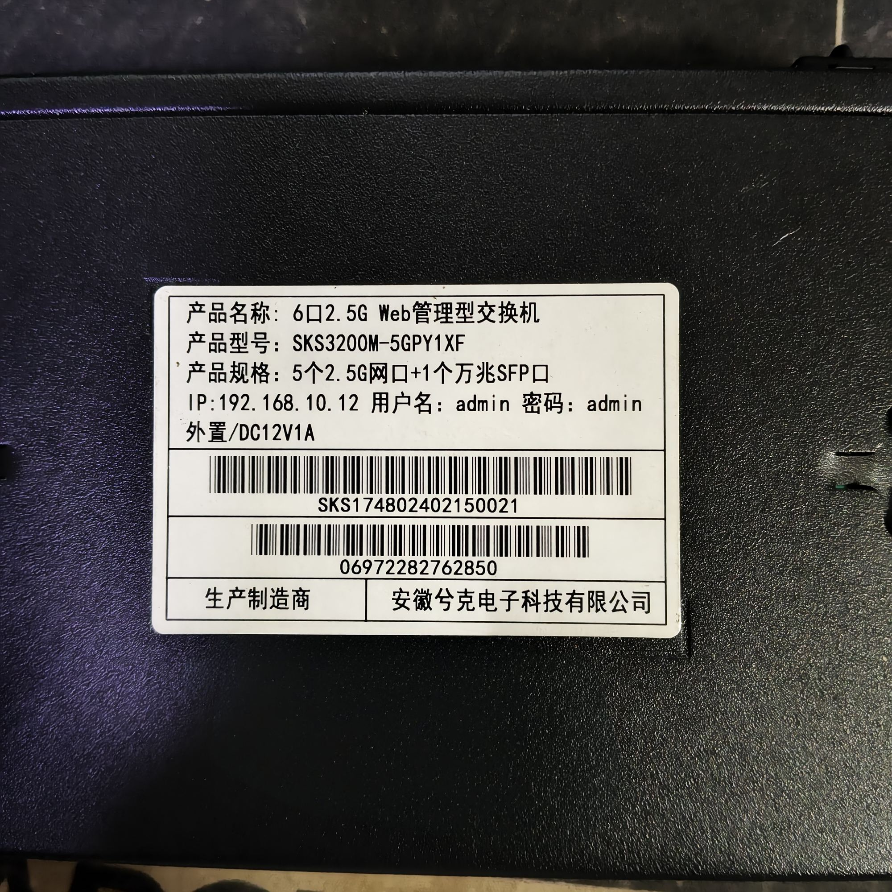
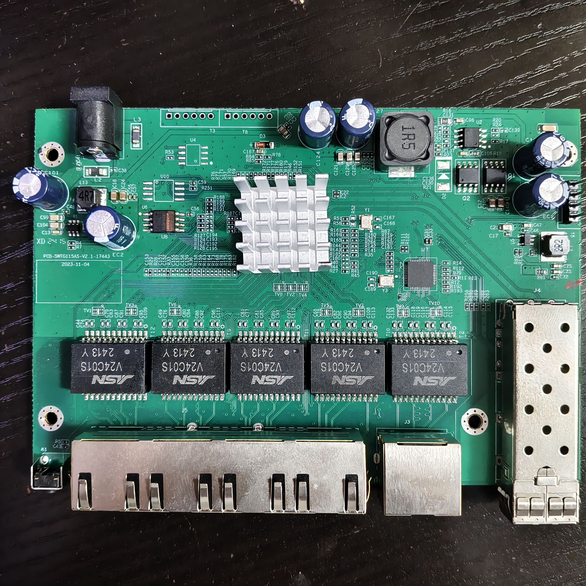
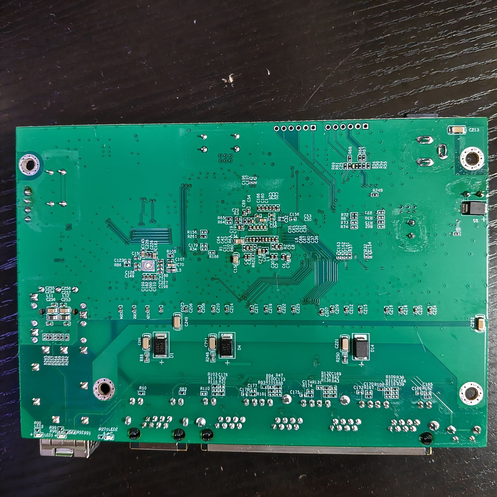

# XikeStor SKS3200M-5GPY1XF (PCB-SWTG115AS-V2.1)

**Status: SUPPORTED — all six ports verified on hardware (2026-10-12).**

Machine target: `MACHINE_SKS3200M_5GPY1XF` (see `machine.h`). It shares its
machine block with `MACHINE_LIANGUO_ZX_SWTGW215AS`, because the board is the
same PCB revision. The two differ only in how they name the board: this target
puts the board revision in `.machine_name` and the retail model in
`.model_name`, so the System panel and the boot log show them as two lines:

```
硬件 (hardware): PCB-SWTG115AS-V2.1
型号 (model):    SKS3200M-5GPY1XF
```

`.model_name` is a new field in `struct machine`; targets that leave it empty
(the ZX-SWTGW215AS one, and every other existing target) show no model line and
behave exactly as before.

- Panel: 5 x RJ45 10/100/1000/2500 Mbps + 1 x 10G SFP+ ("6口2.5G Web管理型交换机",
  5个2.5G网口+1个万兆SFP口).
- Brand: 安徽兮克电子科技有限公司 (XikeStor); sold as `SKS3200M-5GPY1XF`.
- Silkscreen: `PCB-SWTG115AS-V2.1-17443`, dated `2023-11-04`.
- SoC: **RTL8372** (4-PHY class), `isRTL8373 = 0`.
- Flash: **Winbond W25Q16JV** (JEDEC `EF 40 15`, 2 MB) — Dual-I/O is fine, no
  `FLASH_NO_DIO` needed. Factory MAC at `0x1FC000`, like on the ZX-SWTGW215AS.
- The 5th RJ45 is driven by an external RTL8221B (switch port 3).

## Relation to the ZX-SWTGW215AS

The board is identical to the one in [SWTG215AS](SWTG215AS.md)
(`PCB-SWTG115AS-V2.0` / `V2.1`), which documents the same port layout, the same
SFP pins, the reset button on GPIO54 and the LED wiring, and for which
`MACHINE_LIANGUO_ZX_SWTGW215AS` is the verified target. This device is that
board with a XikeStor label, so it is listed here as its own retail variant
rather than as a new board.

## How this board was identified

It arrived mis-flashed with the [PCB-K0801W-V1.0](PCB-K0801W-V1.0.md) image
(8 + 1 ports, `isRTL8373 = 1`). Everything below was read from the running
device over the web interface — this board has no serial console:

| # | Observation | Source | Conclusion |
| - | ----------- | ------ | ---------- |
| 1 | `REGGET: 0x0004: VAL: 0x83720000` | `regget 0004` | RTL8372 → `isRTL8373 = 0` |
| 2 | `Hardware: PCB-K0801W-V1.0` + `INCORRECT MACHINE!` at boot | `version` | wrong machine profile was flashed |
| 3 | The PHY-present flag is 0 for switch ports 0-2, 1 for 3-7 | `/status.json` | only ports **3..8** are populated → `min_port = 3`, `max_port = 8` |
| 4 | Cables in RJ45 #1, #2, #3, #4 come up as switch ports **4, 5, 6, 7** | `/status.json` link field while moving one cable | `log_to_phys_port = {0,0,0,5,1,2,3,4,6}`, i.e. UI ports 1..4 = jacks 1..4 |
| 5 | RJ45 #5 comes up as UI port 5 (switch port 3) at 1G and 2.5G | same | the RTL8221B port is wired to switch port 3 |
| 6 | A module in the cage flips GPIO30 (`0xff7bedff` → `0xbe7bedff`) and `sfp` reports its data; removing it flips GPIO30 back | `gpio`, `sfp` | `pin_detect = GPIO30` |
| 7 | GPIO37 reads 0 with the module in and no fibre, 1 with the cage empty | `gpio` | `pin_los = GPIO37` |
| 8 | The module EEPROM reads as `Hisense LTF8502-BC+` (vendor/model/serial intact), and the port linked at 10G | `sfp`, `/status.json` | `i2c = SDA4/SCL3_MDC1`, `sds = 1` |
| 9 | `JEDEC ID: 0xef 0x40 0x15` | `flash j` | Winbond W25Q16JV, 2 MB |
| 10 | After setting `mac_flash_offset`, the MAC became the factory `8c:a6:82:70:85:aa` instead of a generated one | `/information.json` | the MAC really is at `0x1FC000` on this board |

## Bring-up status (2026-10-12)

| Item | State | Evidence |
| --- | --- | --- |
| SoC class, `isRTL8373 = 0` | **verified** | `regget 0004` = `0x83720000`, no `INCORRECT MACHINE!` |
| 5 + 1 port layout and port order | **verified** | one-cable-per-jack pass: UI 1..5 = jacks 1..5, UI 6 = SFP |
| RJ45 at 1G and 2.5G | **verified** | link 1000M on jacks 1-4, 2.5G on jacks 1 and 5 |
| SFP port | **verified** | module detected, EEPROM read, port linked at 10G |
| SFP `pin_detect` / `pin_los` / `i2c` / `sds` | **verified** | module insert/remove plus EEPROM read |
| `mac_flash_offset = 0x1FC000` | **verified** | factory MAC now used |
| `reset_pin = GPIO54` (reset button) | GPIO54 is the button on this PCB; the handler that times the press was broken on the RTL8372 (see [SWTG024AS](SWTG024AS.md#why-the-button-used-to-do-nothing-at-all)) and is fixed in shared code | not button-tested on this unit yet - the same fix is verified on the SKS3200M-4GPY2XF |
| RJ45 LEDs (`led_sets[0]`, `port_led_set`) | **verified** | 2.5G lights the right-hand LED green, 1G/100M lights the left-hand LED orange, as the set 0 bitmasks and the ZX-SWTGW215AS LED table both say |
| `high_leds` (pin 28 = system LED) | **verified** | the front-panel LED is lit steady while the switch runs; `PIN_MUX_0 = 0x38000000` muxes pins 27/28/29 |
| SFP LED (`led_sets[1]`) | same-PCB target (`0x50155` = 10G/5G/2.5G/1G/100M) | the SFP port linked at 10G; the LED was not read off the panel |

## Factory default configuration

Both XikeStor targets embed `config-xikestor.txt` instead of `config.txt`
(selected by machine target in the Makefile), so a freshly flashed board comes up
at **192.168.10.12** with the project's default login password. The file holds
only the IP, gateway and netmask; adding a `passwd` line to it would replace the
default password.

## Installing

The stock firmware is a Realtek reference image with a web UI but it cannot be
reproduced from a dump, so keep a full 2 MB backup of the chip. Once any
RTLPlayground image runs on the board:

- board already running RTLPlayground → upload
  `output/rtlplayground-<version>-SKS3200M_5GPY1XF.bin` (512 KiB) in the web UI
- board still running the stock firmware → upload the one-shot installer
  `installer/output/rtlplayground_oem_upgrade.bin`

Build:

```bash
make MACHINE=SKS3200M_5GPY1XF      # or MACHINE=LIANGUO_ZX_SWTGW215AS, same board
```

Do not write a padded 2 MiB programmer image through the web interface, and do
not overwrite `0x1FC000` when programming the chip directly — that is where the
factory MAC lives.

## Board pictures

Label (bottom of the case): 6-port 2.5G web-managed switch, `SKS3200M-5GPY1XF`,
5 x 2.5G + 1 x 10G SFP+, DC 12V 1A.




