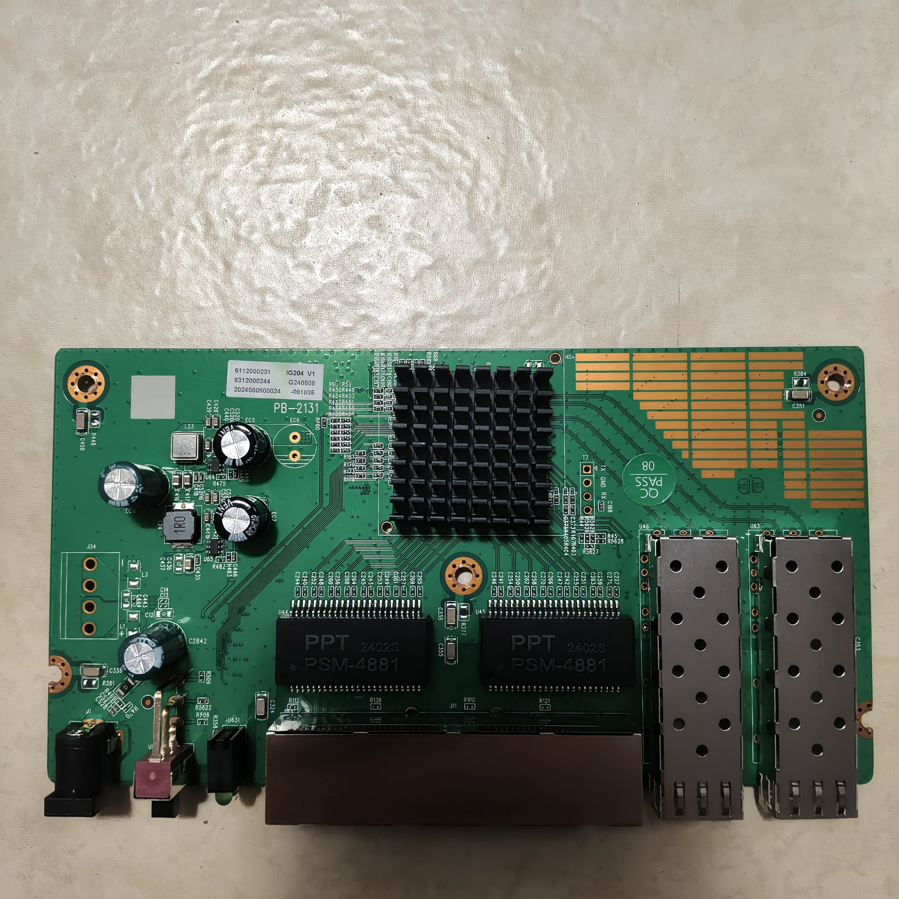
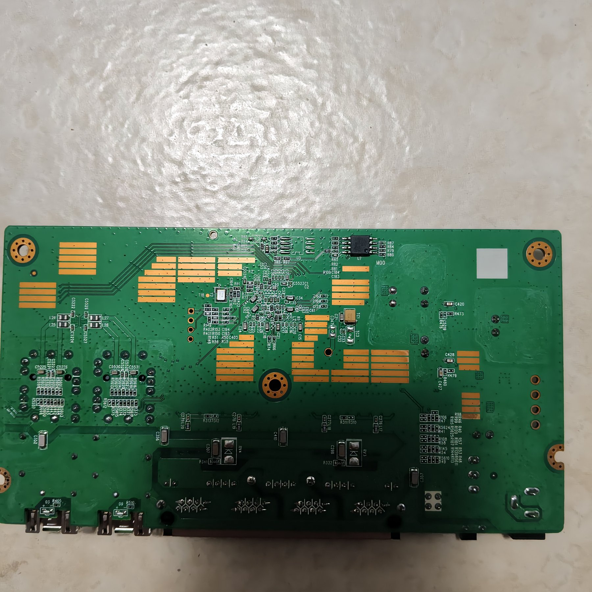
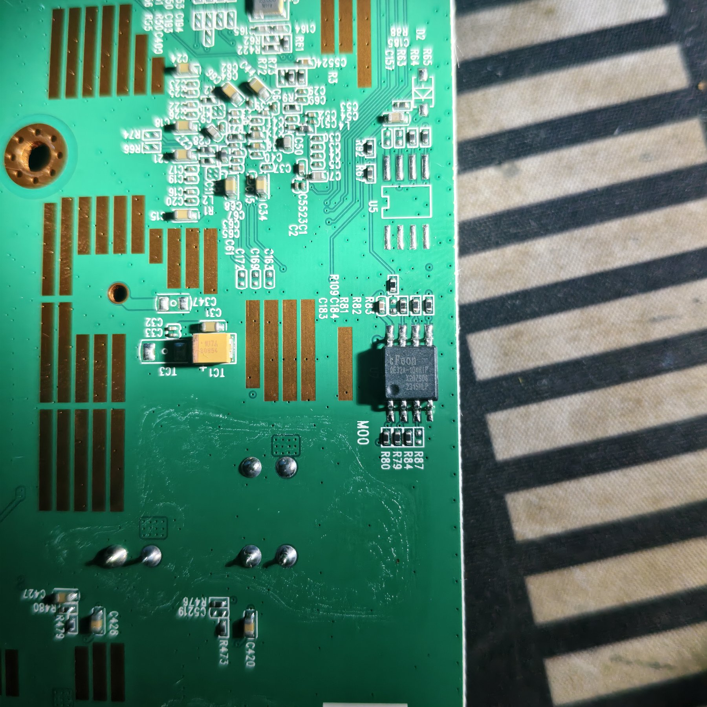
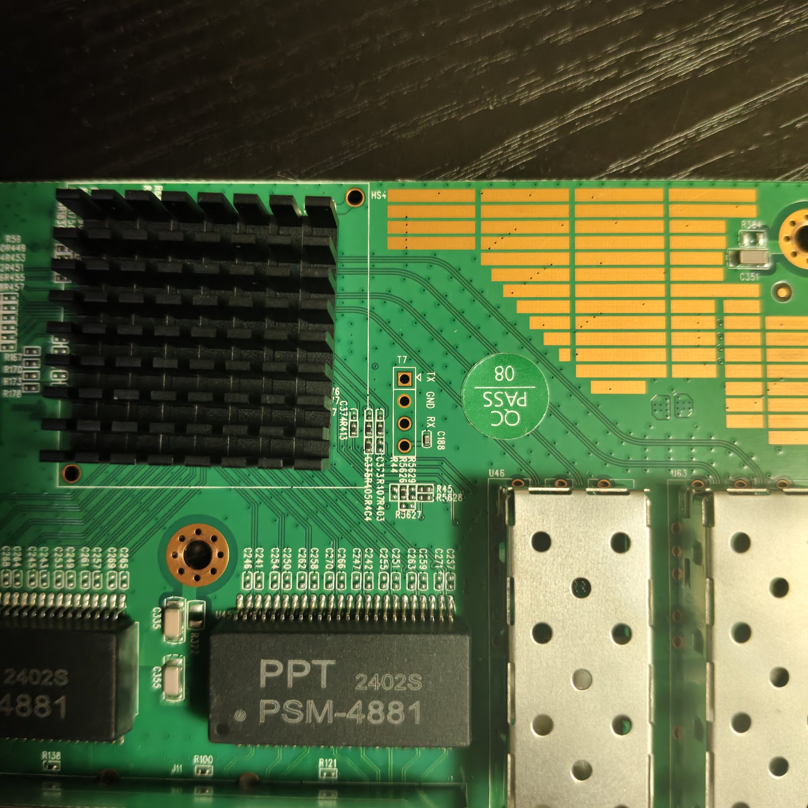

# IG204 4+2 / PB-2131

RTL8372-based 4 × 2.5GBASE-T + 2 × SFP+ unmanaged switch ("IG204 4+2"). The
PCB silkscreen says **PB-2131** and the board label **IG204 V1**; the same
board is sold under several brand names, the Steamemo IG204-V1 among them.

Machine target: `MACHINE_STEAMEMO_IG204_V1` — the System tab shows
**Hardware `PB-2131`** and **Model `IG204 V1`**.

**Status: supported — ports, LEDs, both SFP cages and the VLAN switch were
verified on the PB-2131 unit (2026-10-29).** The board carries an RTL8372 with two SerDes and
no external PHY, so `isRTL8373 = 0`.

## Conformance with the manual (说明书)

The unit ships with a `2.5G高速交换机用户手册` (a photo of it is kept next to
the board photos: `photos/STEAMEMO_IG204_V1/manual.jpg`). Every claim that the
firmware can influence is implemented as the manual describes:

| Manual | Implementation here | Checked |
|---|---|---|
| 10/100/1000M/2.5G RJ45 自适应 + 10G SFP+ | 4 RJ45 with AN advertising 10H/10F/100H/100F/1000F/2500F; 2 SFP+ | `port <n> show`, both cages 10G |
| IEEE 802.3 / 3u / 3ab / 3bz / 3ae / 3x | PHY/MAC defaults; 802.3x pause is negotiated | `port 1 show`: `Pause negotiated: TX RX` |
| Auto MDI/MDIX | PHY auto crossover | not separately measured |
| 10/100 半双工+全双工, 1000M/10G 全双工 | exactly what the AN advertises | `port 1 show` |
| MAC 自主学习与老化, 4K 表 | chip default: learning on, entries aged by the hardware; the table size is a SoC property | `l2` shows the host learned on RJ45 1 |
| 60Gbps 背板带宽 / 高包转发率 | SoC capability | — |
| **VLAN OFF 默认**: 所有端口自由通讯 | isolation masks all-port (`0x3f8`) | `regget 50d0` |
| **VLAN ON**: RJ45 互相隔离, 仅与 SFP+ 通讯, 屏蔽广播风暴 | each RJ45 allowed only to SFP1+SFP2 (+ CPU, see below); mask `0x308` | `regget 50d0..50dc` |
| **PWR** 常亮 = 已加电 | hard-wired to the supply | lamp stays on |
| **SYS** 慢闪 = 正常工作 | `LED_MODE` bits 17:16 = 2 while idle (`sys_led_blink_idle`) | slow blink on the unit |
| **LINK/ACT 绿灯** 点亮 = link, 闪烁 = 数据传输 | green = `1G|100M|10M|LINK|ACT` | 1G link green, blinks on traffic |
| **闪烁 = 数据传输中** (the same lamp row as the green state) | both lamps carry `LEDS_ACT`: amber = `2G5|LINK|ACT` | 2.5G link blinks on traffic (A/B test below) |
| **黄灯** = 速率为 2.5Gbps | amber = `2G5|LINK|ACT`, lit at 2.5G | RJ45 1-4 amber at 2.5G |

One deliberate difference: in VLAN mode a RJ45 port may still reach the
**CPU port** (the switch's own management interface, mask bit 9). The manual's
"仅与 SFP+ 口通讯" describes forwarding between the front ports, and without
the CPU port the web interface and the console-over-network would be
unreachable from any copper port. If a strict "only the SFP cages" is wanted,
the mask can be built without bit 9 in `vlan_switch_poll()`.

## Board



Bottom side:



- **SoC**: RTL8372 under the black heatsink (`regget 0004` = `0x83720000`)
- **Magnetics**: 2 × `PPT PSM-4881`
- **Flash**: stock **cFeon EN25QE32A-104HIP, 4 MiB** (32 Mbit, SOP-8, `U5` on
  the bottom side next to the SFP cages). The verified unit was reflashed with
  a **1 MiB Macronix MX25L8005M** and runs the 512 KiB image from it.
  See *Flash* below.
- **Reset button**: the board has no button (and no button footprint next to
  the barrel plug) → `.reset_pin = GPIO_NA`.
  Restore the compiled-in configuration with the web UI's *Restore factory
  defaults* or the `defaults` console command.
- **Power**: 12 V 1 A barrel plug.



## Port layout

| Front panel | Logical port | Physical (ASIC) port | Type |
|---|---|---|---|
| RJ45 1 | 4 | 1 | 2.5GBASE-T |
| RJ45 2 | 5 | 2 | 2.5GBASE-T |
| RJ45 3 | 6 | 3 | 2.5GBASE-T |
| RJ45 4 | 7 | 4 | 2.5GBASE-T |
| SFP1 (left cage) | 8 | 5 | SFP+, SerDes 1 |
| SFP2 (right cage) | 3 | 6 | SFP+, SerDes 0 |

Verified with `port <n> show` on the unit: physical 1-6 report logical
04, 05, 06, 07, 08, 03. The two cages therefore cross over in the logical
numbering, exactly like the other 4 + 2 boards of this family.

## LEDs

Each RJ45 jack has two lamps: **2.5G = amber, 1000/100/10 Mbps = green**
(the same convention as the F7005-2.5GPOE and KP-9000 boards). The SFP cages
each have one lamp that is lit at any supported speed. Every port lamp blinks
while data flows - see *Link lamps blink with traffic* below for why the amber
slot needs its own `LEDS_ACT`.

The RTL8372 reset value of `LED_GLB_IO_EN` is `0x77ffff00`, which leaves LED
pads 0-7 disabled. `machine_custom_init()` writes `0x7fffffff`, so every pad is
available; the pads this panel does not use are pointed at `0x02` (a signal
that is never true), not at `0x3f`: a pad left at `0x3f` floats, and a floating
lamp whose pad is pulled down lights up.

The pad map is the one that was already in the target for this PCB. It was
confirmed on the unit one port at a time (2026-10-29):

| Jack | amber (2.5G) pad | green (1G/100M/10M) pad | third pad (unused) |
|---|---|---|---|
| RJ45 1 (logical 4) | 12 | 13 | 14 |
| RJ45 2 (logical 5) | 15 | 16 | 17 |
| RJ45 3 (logical 6) | 18 | 19 | 20 |
| RJ45 4 (logical 7) | 21 | 22 | 23 |
| SFP1 (logical 8) | lamp on pad 9 (pads 25-27 are SET1 slots 1-3, unused) | — | — |
| SFP2 (logical 3) | lamp on pad 24 (pads 8, 10, 11 are SET1 slots 1-3, unused) | — | — |

Measurement: with a 2.5G link on the port only the amber lamp lights and the
green lamp is dark; forcing the same port to 1000 Mbps (`port 7 1g full`)
switches the jack from amber to green. Both directions were checked on RJ45 4;
RJ45 1-3 showed amber at 2.5G. A module linked at 10G lights the lamp next to
its cage.

### Link lamps blink with traffic

The manual's "闪烁:数据传输中" belongs to the LINK/ACT row and applies to both
colour states, so the LED mask needs `LEDS_ACT` **in the amber slot as well**.
The first version of this target had amber = `2G5|LINK` only: at 2.5G the lamp
was solid and the green lamp stayed dark, so nothing on panel blinked while
data flowed (reported by the user 2026-10-29). Amber is now
`2G5|LINK|ACT`, the same as the lamps of the other boards of this family
(`MACHINE_SWTG024AS_V2_0`, `MACHINE_SKS3200M_4GPY2XF`, `MACHINE_HI_K0801WS`).

Verified on the unit by watching the pad level, not the panel: the second word
of the `gpio` command is the *change* since the previous call, and LED pad 21
(RJ45 4's amber lamp) appears in it while traffic flows. With the link up and
`ping -f` running:

| `LED1_0_SET0` slot 0 | 16 `gpio` samples, pad 21 changed in |
|---|---|
| `2G5|LINK|ACT` (new) | 6 |
| `2G5|LINK`, written live with `regset 6548 01740041` | 0 |
| `2G5|LINK|ACT`, restored with `regset 6548 01740141` | 6 |

The register encodes two slots: byte 0 is the low byte of slot 0's mask, byte 2
the low byte of slot 1's, so `0x01740141` is amber `0x0141` = `2G5|LINK|ACT` and
green `0x0174` = `1G|100M|10M|LINK|ACT`. Pad 21 drives signal `0x1c` = port 7
slot 0 (the mux index is the pad, the value is `ASIC port * 4 + slot`).

The system LED is on pad 28 and is driven by `LED_MODE` bits 17:16. The manual
asks for **SYS slow blink while the device works normally**, so this target sets
`sys_led_blink_idle` and the firmware leaves the lamp at `SYS_LED_SLOW`
(bits 17:16 = 2, register `0x0022e6b0`) once boot is done; the flashing
indications still use `SYS_LED_FAST`. The second lamp next to it (PWR) is lit as
soon as the board has power; whether the SoC drives it was not measured.

## SFP cages

| Cage | Detect | RX_LOS | EEPROM I²C | SerDes | Logical port |
|---|---|---|---|---|---|
| SFP1 (left) | GPIO30 (`ACL_BIT3_EN`, low = module in) | GPIO37 | SDA4/SCL3 = GPIO39/GPIO40 | 1 | 8 |
| SFP2 (right) | GPIO50 (`I2C_SCL2`, low = module in) | GPIO51 (`I2C_SDA2`) | SDA3/SCL3 = GPIO41/GPIO40 | 0 | 3 |

Both cages were verified with two different 10G modules moved from one cage to
the other:

```
> sfp
Slot 1 - Rate: 67  Encoding: 06
Intel Corp      AFBR-709DMZ-IN2 G4.1
...
Slot 2 - Rate: 67  Encoding: 00
AVAGO           AFBR-2CAR07Z-BD1
```

`stat` shows `SFP IN / 10G` on physical port 5 or 6 depending on which cage
holds the module, and the module's RX power is non-zero (light received). No
`sds` or `sdsset` workaround is needed: the target's detect pins make
`handle_sfp()` read the EEPROM and program the SerDes for 10G on insertion.

## VLAN switch

The front panel has a slide switch labelled **VLAN ON/OFF** to the left of the
SYS LED (the pink slider on the board's front edge, between the barrel
plug and the two lamps).

It is wired to **GPIO36** and reads **1 when on, 0 when off**. Measured on the
unit 2026-10-29 by flipping it with the GPIO input register of both words
sampled once a second: bit 4 of `0x0048` follows the switch in all 10 samples
per position, while the neighbouring bits 2 and 10 only show the MDC/SPI
traffic noise.

Two details matter if the pin is ever re-used:

- `PIN_MUX_1` (0x7f90) **bit 30 must stay set**. With it clear the pin level
  does not reach the input register and the switch reads 0 in both positions.
  `gpio_input_setup(GPIO36_PWM_OUT)` sets it, which is why the target calls it
  from `machine_custom_init()`.
- No read of GPIO36 was found in the 4 MiB stock dump; the only GPIO input
  reads there are GPIO30/37/50/51 (the SFP detect/LOS pins). So the switch has
  no vendor semantics to copy and the behaviour below is this project's
  definition.

Behaviour in RTLPlayground (`.vlan_switch_pin = GPIO36_PWM_OUT`,
`vlan_switch_poll()` in `rtl837x_pins.c`, called once a second from the main
loop):

| Switch | RJ45 1-4 | SFP cages | CPU port |
|---|---|---|---|
| **OFF** | may talk to every port (mask `0x3f8`) | every port | every port |
| **ON** | **isolated from each other**, may only reach the SFP cages and the CPU (mask `0x308`) | every port | every port |

So "VLAN on" is the usual client-isolation mode of these unmanaged switches:
the four RJ45 ports cannot talk to each other, but all of them can still reach
whatever is plugged into the SFP cages (the uplink) and the management
interface keeps working. The switch is polled, so flipping it takes effect
within a second, without a reboot; the serial console prints

```
VLAN switch: ON, the RJ45 ports are isolated from each other
```

and the **Isolation** tab of the web UI shows the resulting masks (it reads the
same registers). A change made in that tab is overwritten the next time the
switch is flipped.

The dashboard has a card for it: on boards that report `vlan_switch` the
dashboard is a 2 x 2 grid - **ports** top left, **VLAN switch** top right (same
width and height as the port card), **system** bottom left and **traffic**
bottom right. Boards without the switch keep the port strip full width: the card
stays hidden and the strip spans both columns.

The card is titled *VLAN panel switch settings* and has two switches, in the
same style as the spanning-tree port configuration:

| Row | Meaning |
|---|---|
| **VLAN panel switch** | read-only, follows the position of the panel switch; the note under it says what that position does and that it has no effect while the second switch is off |
| **Use VLAN panel switch** | whether the panel switch drives the isolation at all (`vlan switch on|off`) |

With **Use VLAN panel switch** on (the default), the panel switch decides:
ON isolates the RJ45 ports from each other, OFF lets all ports talk. With it
off, the panel switch is ignored and VLANs / port isolation are configured in
the web UI (the Isolation tab, or `isolate` on the console) - the firmware
clears the isolation to "allow all" once when the function is turned off and
then leaves the registers alone. The dashboard re-reads `/information.json`
every five seconds while it is open, so the read-only switch follows the panel
within a few seconds.

**How it interacts with the 802.1Q VLAN configuration** (tested on the unit
2026-10-29): the panel switch only writes the port-isolation registers, it
never touches the VLAN table or the PVIDs. So with the function on and the
panel switch at ON, the VLANs page still accepts every change - a VLAN can be
created, renamed and given PVIDs, and `/vlan.json` shows it - but the *traffic*
between two RJ45 ports stays blocked by the isolation, whatever VLAN they are
in. With the function off the isolation is "allow all" and the VLAN
configuration alone decides forwarding, so the two never fight over the same
registers; the only thing to remember is that isolation wins over VLAN
forwarding while the panel switch is in effect.

The web pages that decide where a frame may go are **mutually exclusive with
the panel-switch function**, not with the position of the physical switch: as
long as *Use VLAN panel switch* (`vlan switch on`, the default) is enabled, the
panel switch owns the LAN ports, so the **VLANs**, the **Isolation** and the
**Port mirroring** tabs show a yellow notice and everything below it is greyed
out and read-only - you can look, but nothing can be changed. Turning the
function off (`vlan switch off`, or the switch on the dashboard) gives all three
pages back; that is the one and only way to configure VLANs, isolation or
mirroring by hand. The panel switch position itself does not matter for the
lock: with the function on, the pages stay read-only whether the slide switch
is at ON or OFF.

> 「启用VLAN面板开关」已开启：LAN 口的 VLAN 与隔离由面板拨刀接管。以下设置只读、仅供查看；如需在网页中配置 VLAN，请先在仪表盘关闭该开关。

(The mirroring tab carries the same notice with "端口镜像" instead of "VLAN".)

**What else the isolation does not touch** (checked on the unit with the
isolation at `0x308`: `stp on`, `mirror 1 2`, `lag 1 2 3` and `eee on` were all
accepted and reported normally, and the masks stayed at `0x308`):

| Feature | Effect of the panel switch |
|---|---|
| STP / RSTP | none - BPDUs go through the CPU and port states are independent of the isolation table; the SFP cages can still loop, so STP stays useful |
| port mirroring | the configuration is independent of the isolation table, but a copy from one RJ45 port to another is RJ45 <-> RJ45 traffic and may be dropped (not measured), so the page is locked together with the VLAN and Isolation pages - turn the function off to configure a mirror |
| LAG | the configuration is independent; traffic from one RJ45 port into a copper LAG is blocked like any RJ45 <-> RJ45 traffic, a LAG of / towards the SFP cages works |
| IGMP snooping | multicast from the SFP cages to the RJ45 ports works, RJ45 <-> RJ45 multicast is isolated by design |
| EEE, bandwidth limits, storm control, MTU, LLDP, port on/off + speed + name, MAC table, counters | none |

So the pages that decide **where a frame may go between the RJ45 ports** are
greyed out and read-only while the panel switch is in effect: **VLANs** (the
VLAN table, PVIDs and ingress filtering), **Isolation** (the very same registers
the panel switch writes) and **Port mirroring** (a mirror between two RJ45
ports would be such forwarding). The other pages keep working normally.

The setting is a normal configuration command and is saved with the rest:

```
vlan switch on      # the panel switch controls isolation (default)
vlan switch off     # ignore the panel switch, use the configured VLANs
vlan switch         # show the current setting
```

To get the same without the switch, use the console (`0` stands for the CPU
port; the port numbers are the front-panel ones, cages 5 and 6):

```
isolate 1 5 6 0     # jack 1 may only reach the two cages and the CPU port
isolate 1 off       # back to "allow all"
```

That writes the same masks the switch writes (`0x308` / `0x3f8`).

## Console

Header **T7** next to the SFP cages, four holes, top to bottom:

| T7 pin | Signal |
|---|---|
| 1 | TX (SoC output) |
| 2 | GND |
| 3 | RX (SoC input) |
| 4 | 3V3 |



- RTLPlayground: **115200 8N1**, 3.3 V TTL.
- The stock non-managed Realtek reference image of this family runs at
  9600 8N1 with the `RTL8371B:` prompt (the 4 MiB dump contains that string;
  the baud rate was not re-measured on this unit, it is the family default).

The stock firmware of this board is the same unmanaged reference image as on
the other non-managed boards: it has no web interface, so the first
installation needs an SPI programmer (SOP-8 clip or desoldering).

## Flash

The stock part is a **cFeon EN25QE32A-104HIP, 4 MiB** (`cFeon` /
`EN25QE32A-104HIP` markings). A programmer dump of the untouched 4 MiB chip was
kept locally as `QE32A.bin` (4 MiB, first 0x1368F bytes used, rest `0xFF`).

The verified unit was reflashed with a **1 MiB MX25L8005M** because that is
what was at hand; the 512 KiB image is written at offset 0 and the 1 MiB part
is large enough for the web updater, which stages at `0x80000` and needs
`flash_size >= 0x100000`. `flash` reports `1 MB` and the web UI's firmware
upload works.

Build and flash:

```bash
make MACHINE=STEAMEMO_IG204_V1 FLASH_NO_DIO=1
```

`FLASH_NO_DIO=1` is how the unit was verified (single-bit fast read). The
4 MiB EN25QE32A was not tried with an RTLPlayground image, so the stock part's
read mode is untested.

The image is 512 KiB; write it at offset 0 with an SPI programmer, or upload
`output/STEAMEMO_IG204_V1/rtlplayground-*.bin` (512 KiB, unpadded) with the web
interface once RTLPlayground runs.

## Loop protection

STP is **off** by default. Bringing several links of this switch to the same
second switch at once (for example RJ45 1-3 plus both SFP cages) forms a loop;
on the verified unit that produced a broadcast storm of about 900k packets/s
and the management interface stopped answering until the extra links were
pulled. Connect one link between the two switches, or enable STP first
(`stp on`, then save the configuration).

## Verified

| Item | Result |
|---|---|
| SoC | RTL8372 (`regget 0004` = `0x83720000`), no external PHY |
| Flash | 1 MiB MX25L8005M with `FLASH_NO_DIO=1`; boots, web update works |
| RJ45 1-4 | 2.5G links, `port 1-4 show` reports logical 04-07 |
| RJ45 LEDs | 2.5G = amber, 1G = green, both checked on RJ45 4; 1-3 amber at 2.5G; **both blink with traffic** (`LEDS_ACT`, A/B tested through `regset 6548`) |
| SFP1 (left) | 10G link, `sfp` reads the Intel AFBR-709DMZ-IN2, lamp lit |
| SFP2 (right) | 10G link, `sfp` reads the AVAGO AFBR-2CAR07Z-BD1 |
| SYS LED | slow blink while idle, pad 28 (`LED_MODE` bits 17:16 = 2, `sys_led_blink_idle`) |
| PWR LED | on with power; SoC control not measured |
| Reset button | not present, `.reset_pin = GPIO_NA` |
| VLAN switch | GPIO36, ON = 1 / OFF = 0 (10 samples each); ON gives the copper ports mask `0x308`, OFF restores `0x3f8` |
