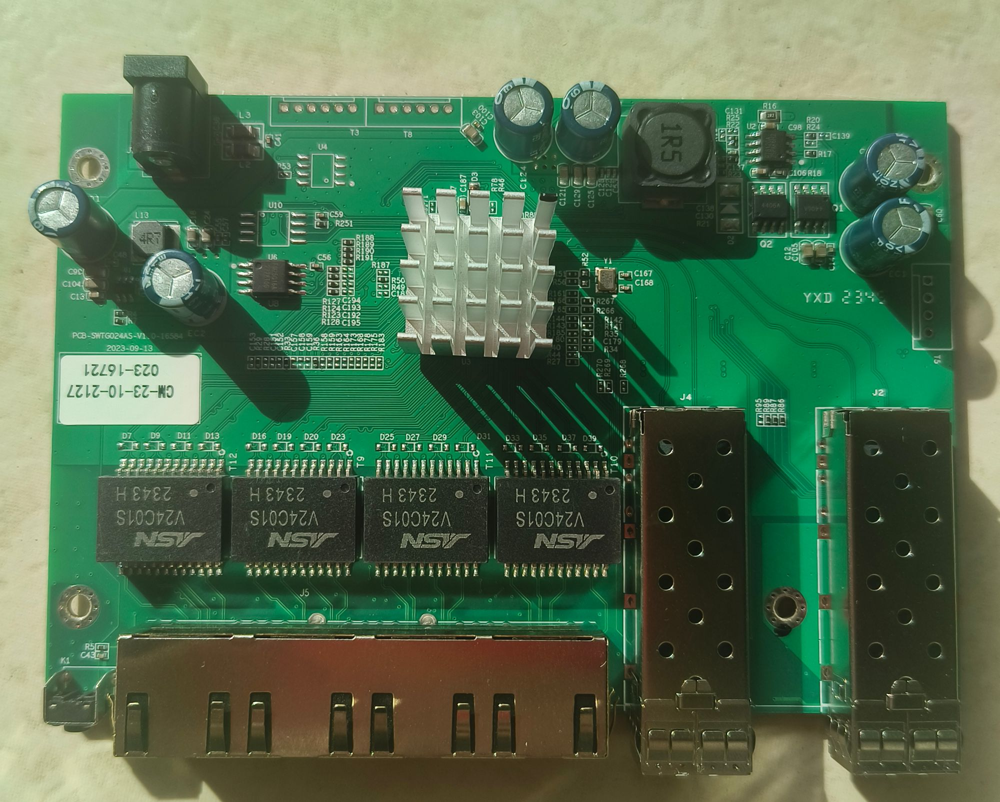
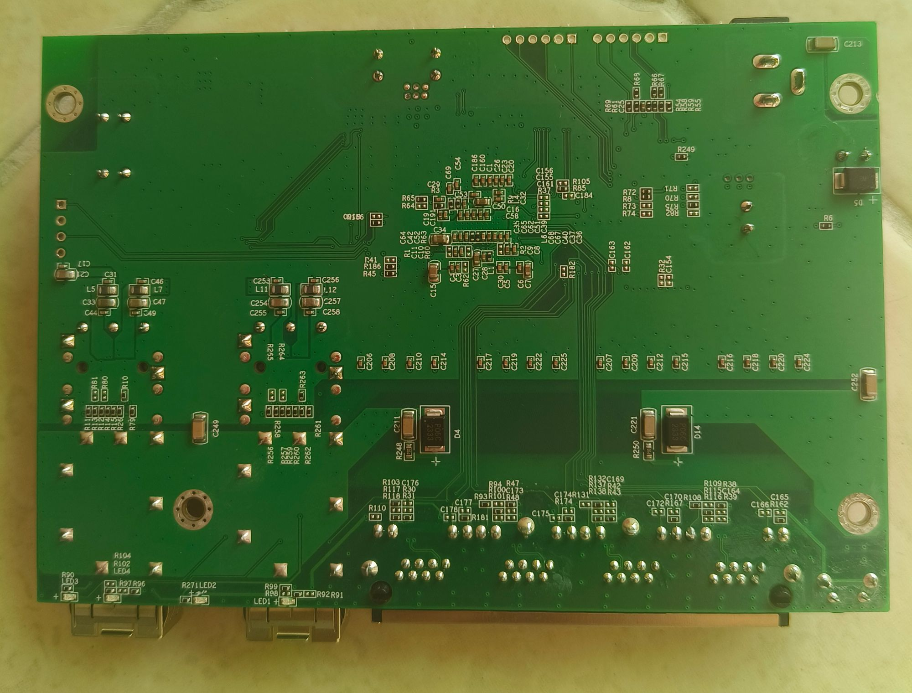
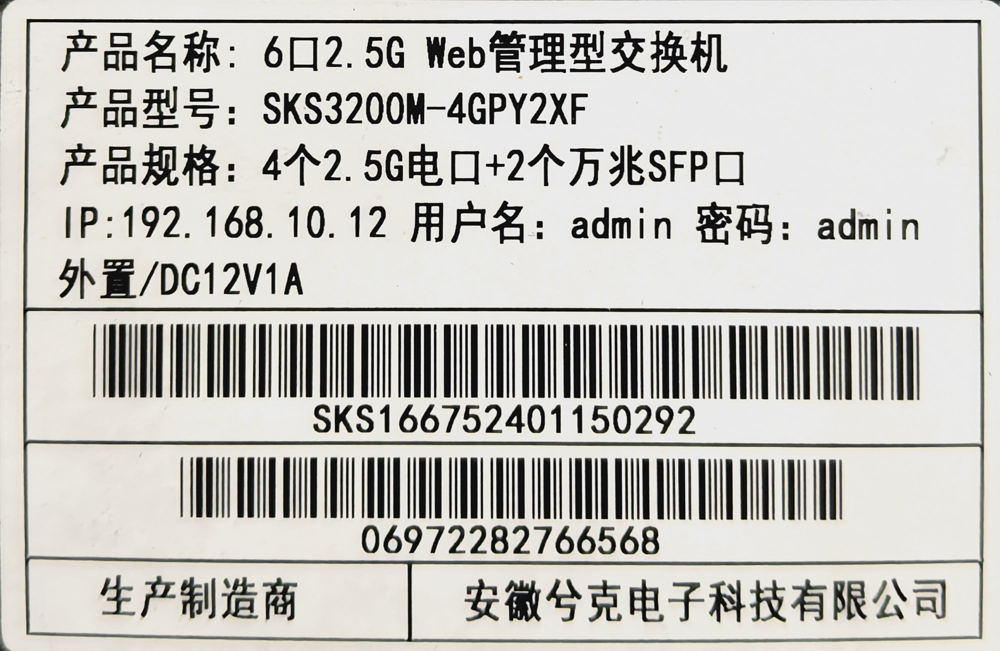

### SWTG024AS
SWTG024AS has at least 4 variants that look the same.

Variants are `managed` and a `unmanaged` version.
But both have pcb version `v1.0` and `v2.0`. 
Also the RJ45 connectors can be all plastic/non-shielded or with metal shielding.

## Brands
|Brand|Type|Managed|PCB|PCB Label|Flash|Chip RTL|
|---|---|---|---|---|---|---|
| LIANGUO |SWTG024AS |No|  SWTG024AS-v2.0-17452 | CM-23-11-2336 023-17453| 512 KiB | 8272 |
| Horaco |ZX-SWTG124AS | Yes |  SWTG024AS-v2.0 | ??? | ??? | 8272 |
| XikeStor |SKS3200M-4GPY2XF | Yes |  SWTG024AS-v1.0 | CM-23-08-2043 023-16721 | 2048 KiB | 8272 |
| Sodola | SL-SWTG124AS-D | Yes | SWTG024AS-v2.0-17452 | ??? | 2048 KiB | 8272 |

## RTLPlayground targets

Both PCB revisions take the same machine parameters, so they share one machine
block. They differ in what they report as the board, which the web UI shows as
硬件 (hardware) and 型号 (model):

| Target | 硬件 (hardware) | 型号 (model) | Use for |
|---|---|---|---|
| `MACHINE_SWTG024AS_V2_0` | `SWTG024AS-V2.0` | – | the SWTG024AS-v2.0 boards: Lianguo SWTG024AS, Horaco ZX-SWTG124AS, Sodola SL-SWTG124AS-D |
| `MACHINE_SKS3200M_4GPY2XF` | `PCB-SWTG024AS-V1.0` | `SKS3200M-4GPY2XF` | the XikeStor unit on the SWTG024AS-v1.0 PCB |

The two targets are interchangeable as far as the hardware is concerned; pick the
one that matches the silkscreen of your board so the UI states it correctly.

## Installing on the XikeStor unit from its stock firmware

The stock firmware is a CGI-based Realtek SDK image (固件版本 `V10.9.4`, Aug 07
2024, `用户名/密码 admin/admin`, IP `192.168.10.12`). Its **固件升级** page
(`fwug.cgi`) switches the board into the vendor loader, and the loader then takes
the one-shot installer from `installer/output/`; see
[installation method 2](../../README.en.md):

1. POST `cmd=enter_loader` to `fwug.cgi` (in the browser: click 升级 and confirm).
2. The board reboots into the loader, which on this unit **keeps the same IP**
   (`192.168.10.12`, page title `Giga Ethernet Switch V1.0`) - not the
   `192.168.10.247` that other boards of this family use. The stock CGIs are gone
   (`fwug.cgi` answers empty) and the loader menu offers `httpug.cgi`.
3. POST the installer to `/httpupg.cgi?cmd=fw_upgrade` as `multipart/form-data`
   with the file in the `submitFile` field. The page answers 升级成功！, the board
   reboots into the installer, the installer writes RTLPlayground to `0x0` and
   reboots again.
4. RTLPlayground then comes up at `192.168.10.12` with the project's default
   login password (`1234`); the vendor `admin/admin` no longer applies.

Verified on the owner's unit (2026-10-12): upgraded from `V10.9.4` to
`MACHINE_SKS3200M_4GPY2XF`; the UI then reports 硬件 `PCB-SWTG024AS-V1.0` /
型号 `SKS3200M-4GPY2XF`, all six ports, and the factory MAC is **not** restored
(see below).

### Flash chip

`flash j` on that unit reads `EF 40 15`, i.e. a **Winbond W25Q16JV**, so it takes
the default Dual-I/O build; only Boya/BoHong parts (`68 40 15`) need
`FLASH_NO_DIO=1`. (An FM25Q16A was expected for this board; both work with the
default build, so nothing has to change either way.)

This machine block had no `mac_flash_offset`, and the board then came up with a
generated locally administered MAC instead of the one its stock firmware showed
(`1C:2A:A3:23:E4:5E`). `.mac_flash_offset = 0x1FC000` - the offset the
ZX-SWTGW215AS boards use - puts that right: **verified** on the XikeStor unit
(2026-10-12), `/information.json` reports `1c:2a:a3:23:e4:5e` and the hostname
derives from it again. Only `MACHINE_SKS3200M_4GPY2XF` sets it; for the V2.0
boards of the family that area of the flash is unverified.

## Reset button

`K1` sits on **GPIO54** (see [Reset circuit](#reset-ciruit) below), shared with
SFP2's TX-DISABLE through R105 / R85. Both SFP TX-disable pins are `GPIO_NA` in
this machine block, so nothing else drives the pin.

The button is enabled per target:

| Target | `.reset_pin` | Why |
|---|---|---|
| `MACHINE_SKS3200M_4GPY2XF` | `GPIO54_ACL_BIT2_EN` | K1 and R85 are populated on the XikeStor unit - **verified**, see below |
| `MACHINE_SWTG024AS_V2_0` | `GPIO_NA` | on the V2.0 boards R85/K1 may be missing, and a pin that then reads permanently pressed would make the boot-time button handler restore the default configuration on every power-up |

### Why the button used to do nothing at all

`handle_button()` measured the press length from `RTL837X_REG_SEC_COUNTER`. That
register only holds a written value on the RTL8373: on an RTL8372 it always reads
back 0 (`regget 06f4` stays `0x00000000` while the same register counts up on an
RTL8373 board), so the measured length was 0 for every press and all of them ended
in the "short press, no action" case. The press is now timed from the software
tick counter, the way `boot.c` already timed its boot-time press.

### Verified on the XikeStor unit (2026-10-12)

With a marker in the startup configuration (`hostname RESETTEST4GPY`) and
[`tools/reset_button_probe.py`](../../tools/reset_button_probe.py) watching the
pin and the uptime:

| Press | Result | Meaning |
|---|---|---|
| ~5 s | board went away, came back with uptime near 0 and the **marker intact** | `reset_chip()`: restarts, configuration untouched |
| ~11 s | board went away, came back with the **marker gone** and only the image's default configuration stored | `flash_default_config()` + `reset_chip()`: factory reset |
| < 3 s | nothing | "short press, no action" |

`SYS_TICK_HZ` was confirmed against a wall clock (200.0 ticks/s), so the two
thresholds are 3 s and 10 s of real time.

## PCB

V2.0, unmanaged:


### PCB (V1.0, the XikeStor unit)

Silkscreen `SWTG024AS-V1.0` (the XikeStor board's own label reads
`CM-23-08-2043 023-16721`):





# SWTG024AS-v2.0 managed vs unmanged
Changes I found with my board vs [Managed version](https://github.com/up-n-atom/SWTG118AS/tree/main/photos/SWGT024AS-v2.0) of the PCB.

### Bottom
* R105: Installed, goes to R10-PullDown SFP2 (J2) -> TX-DISABLE
* R85: Not Installed (Connected to K1 Reset Button)
* R90: Not installed (System Led)
* LED3: Not installed (System Led)
### Top
* K1: Not installed (Reset Button)
* R95: Installed (SFP2 (J2) signal RX-LOS), means that the managed-version can´t use the RX-LOS function.
* R270: Installed (SFP1 (J4) signal RX-LOS), same here as above.
* R268: Installed (SFP2 (J2) signal TX-DISABLE, but R262 200R pull-down is to high to drive by the SOC, needs mod!)
* U5: Flash is only 512 KiB instead of 2/4 MiB.

### Notes
* `TX-Disable`-SFP2 and Button `K1` share the same GPIO pin via `R105` and `R85`.
  But via `R88`, `TX-Disable`-SFP2 can be mapped to `GPIO36`.
* `TX-Disable` pull-down resistos on both SFP are to low to drive by the SOC.
  We need to make a `Best`-BOM variant so we can use all the featues.

# Connectors

## Port overview

```
┌────────────────────────────────────────────────────────────────────────────────────────┐
│                                                       ┌──────────┐        ┌──────────┐ │
│     ┌─────────┐ ┌─────────┐ ┌─────────┐ ┌─────────┐   │ SFP (J4) │        │ SFP (J2) │ │
│     │  RJ45   │ │  RJ45   │ │  RJ45   │ │  RJ45   │   │ PORT   5 │        │ PORT   6 │ │
│     │  PORT 1 │ │  PORT 2 │ │  PORT 3 │ │  PORT 4 │   │ MAC    8 │        │ MAC    3 │ │
│  O  │  MAC  4 │ │  MAC  5 │ │  MAC  6 │ │  MAC  7 │   │ SerDes 1 │        │ SerDes 0 │ │
│ RST └─────────┘ └─────────┘ └─────────┘ └─────────┘   └──────────┘        └──────────┘ │
└────────────────────────────────────────────────────────────────────────────────────────┘
``` 

## J4

* Location: Left SFP connector `J4`.
* Connected to: 10GMAC number 8, second SerDes.

|`J4` SFP1 PINs | Signal | Component | GPIO | Notes |
|---|---|---|---|---|
|2|	TX_FAULT	        | B-R262	       | --- | | 
|3|	TX_DISABLE	      | B-R263, T-R268 | GPIO38 | R262 = Pull-down 200R|
|4|	MODDEF2 – SDA     |	B-R261, T-R266 | GPIO39 | |
|5|	MODDEF1 – SCL     |	B-R260, T-R267 | GPIO40	| Shared with both SFP |
|6|	MODDEF0 – PRESENT |	B-R259, T-R296 | GPIO30 | |
|7|	RATE SEL          |	B-R257	       | ---    | |
|8|	LOS	              | B-R258, T-R270 | GPIO37 | | 
|9|	TO?               | B-R256	       | ---    | |

## J2

* Location: Right SFP connector `J2`.
* Connected to: 10GMAC number 3, first SerDes.

|`J2` SFP2 PINs | Signal | Component | GPIO | Notes |
|---|---|---|---|---|
|2|	TX_FAULT	        | B-R70	         | ---	  | |
|3|	TX_DISABLE	      | B-R10, B-R105-R, T-R88-L | GPIO54	| R10 = Pull-down 200R |
|4|	MODDEF2 – SDA     |	B-R26, T-R85   | GPIO41 | |
|5|	MODDEF1 – SCL     |	B-R15, T-R87   | GPIO40	| Shared with both SFP |
|6|	MODDEF0 – PRESENT |	B-R14, T-R89   | GPIO50	| |
|7|	RATE SEL          |	B-R12	         | ---	  | | 
|8|	LOS	              | B-R13, T-R95   | GPIO51	| | 
|9|	TO?               | B-R11	         | ---	  | | 

Note: component numbering `<L>-<REFDES>-<SIDE>`
* L: Layer, T=Top, B=Bottom
* REFDEES: full silkscreen like `R123`
* SIDE: Side of the component. when the rj45 are facing towards you are you can read the silkscreen normal.
  L = Left, R=right, B=bottom, T=top or P with a pin number.

### T3, Slave Interface
This connector goes to U4 `I2C EEPROM` and U10 `SPI FLASH`.
Signals are based on that `U4` is likely a I2C-EEPROM, `U10` is likely other SPI-chip.
|`T3` pin|what|Signal|
|---|---|---|
|1| U4-P6, 33R U10-P6 | I2C-SCL, SPI-CLK, Slave SCK/SCL/MDC/EE_SCL |
|2| GND | --- |
|3| U4-P5, U10-P5 | I2C-SDA, SPI-DI/DO, Slave SDI/SDA/MDIO/EE_SDA |
|4| VCC |
|5| 33R -> U10-P2 | SPI-DO/D1 | 
|6| U10-P1 | SPI-CS |
Note: 1 pin is square shaped.

The Slave Interface allows an extenal host to controll the SOC even if the internal MCU is used.
Depending on the `IF_SEL` bootstrap resistors, this can me `I2C`, `SPI` or `SMI`.
On this device it is `I2C` on address `0b1011100` or `0x5c` (7-bit notation).

* I2c Read:  must be a write_read opperation `<Dev-ADDR><RegAddr15:8><RegAddr7:0>` `<DevAddr><Data7:0><Data15:8><Data23:16><Data31:24>`.
* I2c Write: `<Dev-ADDR><RegAddr15:8><RegAddr7:0><DevAddr><Data7:0><Data15:8><Data23:16><Data31:24>`.

Example register `0x0004` return chip id `0x00, 0x00, 0x72, 0x83` = `0x83720000`.

### T5, serial console
|`T5` pin|GPIO|Signal|
|---|---|---|
| 1 | GPIO31 | U0TXD (Output) |
| 2 | GND | |
| 3 | GPIO32 | U0RXD (Input) |
| 4 | 3V3 | |
Note: 1 pin is square shaped.

### T8
|`T8` pin|what|Signal|
|---|---|---|
| 1 | GPIO46 | |
| 2 | GND    | |
| 3 | GPIO48 | |
| 4 | 3V3    | |
| 5 | GPIO47 | |
| 6 | GPIO49 | |
Note: 1 pin is square shaped.

# Reset ciruit
| Cmp | Function |
|---|---|
| T-R78  | 33k PullUp      |
| T-D3   | Discharge Diode |
| T-C187 | RC-Delay        |

Reset-line found at `T-D3-D` active-low.

# GPIO
| HEX VAL. | GPIO   | Component | What |  | GPIO | Component | What |
| -------- | ------ |  ---- | ---- | ---- | ---- | ---- | ---- |
| 00000001 | GPIO00 | T-C151-T, T-R28-T, T-R29-T |?    | | GPIO32 | T-R143-R | U0RXD |
| 00000002 | GPIO01 | T-C152-T                |?    | | GPIO33 |  |  |
| 00000004 | GPIO02 | T-C153-T                |?    | | GPIO34 |  |  |
| 00000008 | GPIO03 | T-R33-T                 |?    | | GPIO35 |  |  |
| 00000010 | GPIO04 | B-C155                  |?    | | GPIO36 | T-R88-L, T-R84-B | Optional SFP2 TX-DISABLE[^2], Reset |
| 00000020 | GPIO05 | B-C156                  |?    | | GPIO37 | SFP1-8, T-R270 | SFP-LOS |
| 00000040 | GPIO06 | T-C157-T                |?    | | GPIO38 | SFP1-3, T-R268 | SFP1 TX-DISABLE[^2] |
| 00000080 | GPIO07 | T-C158-T, R165          |?    | | GPIO39 | SFP1-4, T-R266 | I2C-SDA4 |
| 00000100 | GPIO08 |                         |     |  | GPIO40 | SFP2-5, T-R87; SFP1-5, T-R267; | I2C-SCL |
| 00000200 | GPIO09 | SFP2-LED, T-R36-T       |LED-SFP2 | | GPIO41 | SFP2-4, T-R85 | I2C-SDA |
| 00000400 | GPIO10 |                         |     | | GPIO42 |  U8-P6, T-R124 | SPI-MEMORY, CLK |
| 00000800 | GPIO11 |                         |LEDx[^1] | | GPIO43 | U8-P5, T-R127 | SPI-MEMORY, DI,IO0 |
| 00001000 | GPIO12 |                         |LEDx[^1] | | GPIO44 | U8-P2, T-R128 | SPI-MEMORY, DO,IO1 |
| 00002000 | GPIO13 | PORT1-LED-GREEN         |LEDx[^1] | | GPIO45 | U8-P1, T-R123 | SPI-MEMORY, CS  |
| 00004000 | GPIO14 | PORT1-LED-YELLOW        |LEDx | | GPIO46 | T8-1, T-R188| ? |
| 00008000 | GPIO15 |                         |LEDx[^1] | | GPIO47 | T8-5, T-R190 | ? |
| 00010000 | GPIO16 | PORT2-LED-GREEN         |LEDx[^1] | | GPIO48 | T8-3, T-R189 | ? |
| 00020000 | GPIO17 | PORT2-LED-YELLOW        |LEDx | | GPIO49 | T8-6, T-R190 | ? |
| 00040000 | GPIO18 |                         |LEDx[^1] | | GPIO50 | SFP2-6, T-R89 | SFP-DETECT |
| 00080000 | GPIO19 | PORT3-LED-GREEN         |LEDx[^1] | | GPIO51 | SFP2-8, T-R95 | SFP-LOS |
| 00100000 | GPIO20 | PORT3-LED-YELLOW        |LEDx | | GPIO52 |  |  |
| 00200000 | GPIO21 |                         |LEDx[^1] | | GPIO53 |  |  |
| 00400000 | GPIO22 | PORT4-LED-GREEN         |LEDx[^1] | | GPIO54 | SFP2-3, T-R105-L | SFP2 TX-DISABLE[^2] or via T-R85 to RESET[^3], T-R84-T |
| 00800000 | GPIO23 | PORT4-LED-YELLOW        |LEDx | | GPIO55 | T-R78-B | |
| 01000000 | GPIO24 | SFP1-LED-J4, T-R35      |LED-SFP1 | | GPIO56 | | |
| 02000000 | GPIO25 |                         |     | | GPIO57 | | |
| 04000000 | GPIO26 | ?                       |LEDx | | GPIO58 | | |
| 08000000 | GPIO27 | R44L                    |?    | | GPIO59 | | |
| 10000000 | GPIO28 | LED-SYSTEM, T-R50-R     |LED-SYSTEM  | | GPIO60 | | |
| 20000000 | GPIO29 | T-R187-R                |     | | GPIO61 | | |
| 40000000 | GPIO30 | SFP1-6, T-R269          |SFP-DETECT | | GPIO62 | | |
| 80000000 | GPIO31 | T-R144-R                |U0TXD| | GPIO63 | | |

# LEDs

| NAME | COMPONENTS | GPIO | Active |
| ---- | ---------- | ---- | ------ |
| SYSTEM | T-R50-R (PU-4k2), T-R49-L, T-C185-L, B-R90 | GPIO28 | Low |
| SFP1 | T-R35-L (PU-3k9), T-R34-L, T-C179-L | GPIO24 | Low |
| SFP2 | T-R36-T (PD-4k0) | GPIO09 | High |
| PORT1-LED-YELLOW |  | GPIO14 | Low |
| PORT2-LED-YELLOW |  | GPIO17 | Low |
| PORT3-LED-YELLOW |  | GPIO20 | Low |
| PORT4-LED-YELLOW |  | GPIO23 | Low |

## Which pad drives which lamp (measured on the SKS3200M-4GPY2XF)

The table above names the yellow lamps but not the green ones, and on the
XikeStor unit the green lamps are **not** on the pads the shared table implies.
Measured on the unit (2026-10-13) by driving one pad at a time and watching the
front panel:

| jack | green (2.5G) | amber (1G/100M/10M) |
|------|--------------|---------------------|
| 1    | pad 12       | pad 14              |
| 2    | pad 15       | pad 17              |
| 3    | pad 18       | pad 20              |
| 4    | pad 21       | pad 23              |
| SFP1 (jack 5) | pad 24 | –                  |
| SFP2 (jack 6) | pad 9  | –                  |
| SYS  | pad 28, driven from `LED_MODE` bits 17:16, not through the mux | – |

How to measure that without a datasheet, using only the switch itself:

- `LED_GLB_MUX_1..6` (0x65e0..0x65f4) hold 28 six-bit fields, five per
  register, field *i* at bits `6 * (i % 5)` of `0x65e0 + (i / 5) * 4`. The
  **field index is the pad**, the **value is the LED signal** driving it,
  `id = ASIC port * 4 + slot`; the slot order is the one of `led_sets[set]`,
  i.e. slot 0 = `2G5|LINK|ACT`, slot 1 = `1G|100M|10M|LINK|ACT`, slot 2 =
  `DUPLEX`, slot 3 = `2G5|LINK|ACT`.
- Drive one pad with a signal that is true right now (`22`, the DUPLEX of a
  linked port, is steady - a signal containing `ACT` blinks with traffic and
  makes the reading ambiguous) and point every other pad at a signal this board
  does not have (`4`, port 1).
- `LED_GLB_ACTIVE` (0x65d8) is the per-pad active level. It is a reset value of
  the chip and **nothing in the firmware writes it**; toggling the bit of the
  pad under test makes its lamp blink whichever way it is wired, so the
  measurement does not depend on that value.
- Leaving a pad at `0x3f` ("no signal") does not switch its lamp off: the pad
  floats, and every lamp whose pad is pulled down lights up - which is what
  made the ambers glow with no link. A never-true signal (`4`) drives them to
  their inactive level instead.
- `gpio` (CLI) and the GPIO input registers report the pad levels, which is how
  the drive was checked without looking at the board; the lamp itself can only
  be seen on the panel.

The same measurement gives the per-port link signals: with a 2.5G link on jack 1
the true ids are 16/18/19 (slots 0, 2, 3), with a 1G link on jack 2 they are
21/22 (slots 1, 2) - the speed encoding is the ordinary one, and a 2.5G link does
*not* also set the 1G condition.

`MACHINE_SKS3200M_4GPY2XF` therefore carries its own `.led_mux`, `.port_led_set`
and `led_sets`, and the V2.0 target keeps the values above. Both SFP cages get
`led_sets[1]` (one lamp each, lit at any speed), which is why port 3 and port 8
select set 1.

# Power supply

Board has two supply rails.
`0.95` and `3.3` volt.

## `0.95` Core Voltage.

Voltage is made by a `Richtek RT8120A` Buck converter.
0.95V must be within 3%.

## `3.3` Voltage

Voltage is crated by a `TMI3244T` Buck converter.
3.3V must be within 4.5%.
Chip can deliver up to 4A and the sweetspot is at 1A.
So higher power SFP-modules should work.


[^1]: LEDs are found by just plugin a RJ45 connector and see with cmd `gpio` the status change. But the bit pattern for port 1,2 are diffrent from port 3,4.
[^2]: Only on the unmanaged verions are `R10` and `R268` placed. But the very low pull-down resistor `R10` and `R262` prevent to SOC to drive does pins. A mod is needed.
[^3]: GPIO54 is used for the reset-button. `T-R85` is placed.
