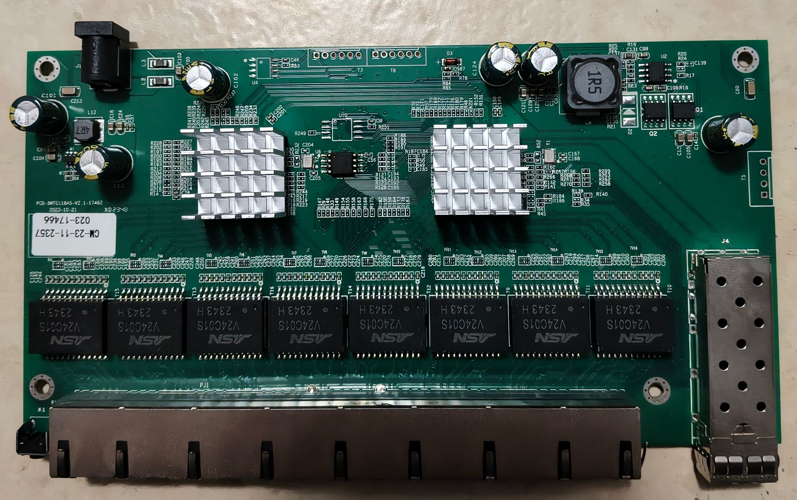
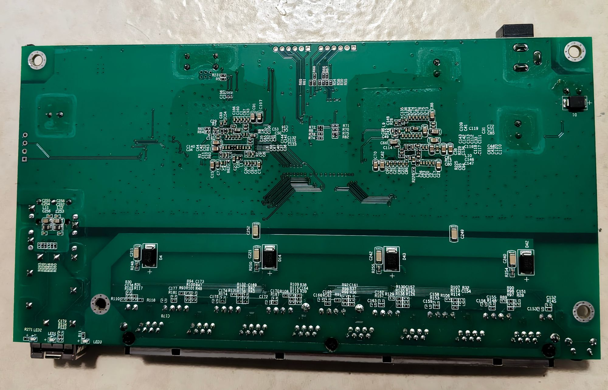
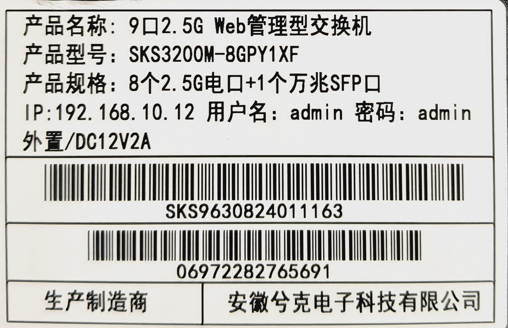

### ZX-SWTGW218AS

## Brands
|Brand|Type|Managed|PCB|Flash|Chip RTL|
|---|---|---|---|---|---|
| Mokerlink | ZX-SWTGW218AS | Yes|  SWTG118AS-V2.0-16029 | 2MB (FM25Q16A)| 8273N + 8224N |
| Sodola | | | | | |
| Horaco | | | | | |
| XikeStor | SKS3200M-8GPY1XF | Yes | SWTG118AS-V2.1-17462 | 2MB (25Q16JVSIQ) | |

The XikeStor unit states its model as `SKS3200M-8GPY1XF` in its web UI and on
its label; an earlier revision of this list called it `SKS3200-8E1X`, which the
unit does not carry.

## RTLPlayground targets

Both PCB revisions take the same machine parameters, so they share one machine
block. They differ in what they report as the board, which the web UI shows as
硬件 (hardware) and 型号 (model):

| Target | 硬件 (hardware) | 型号 (model) | Use for |
|---|---|---|---|
| `MACHINE_SWTGW218AS` | `SWTGW218AS 8+1 Managed Switch` | – | the SWTG118AS-V2.0-16029 boards (Mokerlink ZX-SWTGW218AS) |
| `MACHINE_SKS3200M_8GPY1XF` | `PCB-SWTG118AS-V2.1` | `SKS3200M-8GPY1XF` | the XikeStor unit on the SWTG118AS-V2.1-17462 PCB |

The two targets are interchangeable as far as the hardware is concerned; pick the
one that matches the silkscreen of your board so the UI states it correctly.

## Installing on the XikeStor unit from its stock firmware

The stock firmware is a CGI-based Realtek SDK image ("固件版本 V1.9",
`用户名/密码 admin/admin`, IP `192.168.10.12`) whose **固件升级 (`fwug.cgi`)**
page accepts the one-shot installer from `installer/output/`; see
[installation method 2](../../README.md). The installer copies the RTLPlayground
image into flash, after which the board runs RTLPlayground and is updated
through RTLPlayground's own web UI from then on.

The unit's flash is a **Winbond W25Q16JV** (`flash j` reports `EF 40 15`), so the
default Dual-I/O build is correct for it; only the Boya/BoHong parts
(`68 40 15`) need `FLASH_NO_DIO=1`.

Both XikeStor targets embed `config-xikestor.txt` instead of `config.txt`
(selected by machine target in the Makefile), so a freshly flashed board comes up
at **192.168.10.12** with the project's default login password.

## Reset button

`.reset_pin = GPIO54` was already part of this machine block, but until the shared
fix in `handle_button()` the button did nothing: the handler timed the press from
the seconds register, which only the RTL8373 can hold - see
[SWTG024AS](SWTG024AS.md#why-the-button-used-to-do-nothing-at-all). This board is
an RTL8373, so it also confirms that timing the press from the tick counter did
not regress the chip class the old code did work on.

Verified on the XikeStor unit (2026-10-13) with
[`tools/reset_button_probe.py`](../../tools/reset_button_probe.py):

| Press | Result |
|---|---|
| ~5 s | board reboots, startup configuration untouched (marker hostname still set) |
| ~13 s | factory reset: the marker was replaced by the hostname derived from the factory MAC and only the configuration built into the image was stored |
| <3 s | nothing (same branch as on the other boards; not re-measured here) |

## Photos

## PCB

Photos of the **SWTG118AS-V2.1-17462** board (the XikeStor unit):

See up'n'atom's Repo for the V2.0 board:

https://github.com/up-n-atom/SWTG118AS/blob/main/photos/SWTG118AS-v2.0/SWTG118AS-v2.0-pcb-top.JPG

https://github.com/up-n-atom/SWTG118AS/blob/main/photos/SWTG118AS-v2.0/SWTG118AS-v2.0-pcb-bottom.JPG

